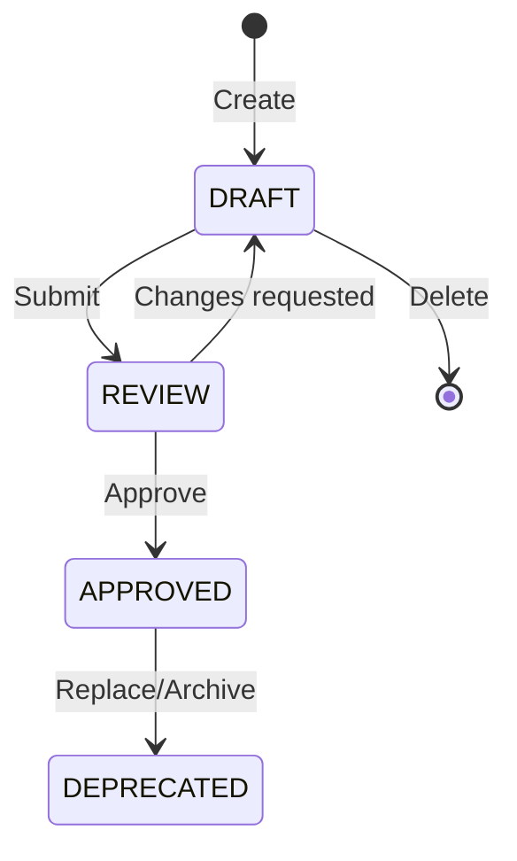

# Domain: Assessment

## 1. Overview

| Attribute | Value |
|-----------|-------|
| **Domain Name** | Assessment |
| **Bounded Context** | Question Bank, Exams, Student Assessment |
| **Core Responsibility** | Question bank, exam definitions, student attempts, scoring |
| **Owner** | Assessment Domain Lead |
| **Status** | Designed |

## 2. Purpose

The Assessment domain manages all evaluation content and processes:
- **Question Bank** - Repository of questions with metadata
- **Exams** - Structured assessments (quizzes, simulations, YKS practice)
- **Attempts** - Student responses, scoring, analytics
- **Quality Control** - Review workflow, versioning, psychometrics

## 3. Core Entities

### 3.1 Question

| Attribute | Type | Constraints | Description |
|-----------|------|-------------|-------------|
| `id` | BIGINT UNSIGNED | PK, AI | Primary key |
| `uuid` | CHAR(36) | NOT NULL, UNIQUE | Public identifier |
| `topic_id` | BIGINT UNSIGNED | NOT NULL, FK → topics.id, RESTRICT | Parent topic |
| `learning_objective_id` | BIGINT UNSIGNED | NULLABLE, FK → learning_objectives.id | Tagged objective |
| `type` | VARCHAR(30) | NOT NULL | Enum: multiple_choice, true_false, short_answer, fill_blank, matching, ordering, essay |
| `content` | TEXT | NOT NULL | Question stem (HTML) |
| `explanation` | TEXT | NULLABLE | Step-by-step solution |
| `difficulty` | TINYINT UNSIGNED | NOT NULL DEFAULT 3 | 1=Very Easy ... 5=Very Hard |
| `bloom_level` | TINYINT UNSIGNED | NOT NULL DEFAULT 2 | 1=Remember ... 6=Create |
| `status` | TINYINT UNSIGNED | NOT NULL DEFAULT 1 | 1=Draft, 2=Review, 3=Approved, 4=Deprecated |
| `is_active` | BOOLEAN | NOT NULL DEFAULT TRUE | Visibility |
| `yks_year` | SMALLINT UNSIGNED | NULLABLE | Source YKS year (e.g., 2023) |
| `yks_session` | TINYINT UNSIGNED | NULLABLE | 1=TYT, 2=AYT |
| `source` | VARCHAR(100) | NULLABLE | Attribution (e.g., "YKS 2023 AYT") |
| `tags` | JSON | NULLABLE | Additional metadata |
| `created_by_id` | BIGINT UNSIGNED | NULLABLE, FK → users.id | Author |
| `updated_by_id` | BIGINT UNSIGNED | NULLABLE, FK → users.id | Editor |
| `created_at` | TIMESTAMP | NOT NULL | |
| `updated_at` | TIMESTAMP | NOT NULL | |
| `deleted_at` | TIMESTAMP | NULLABLE | Soft delete |

### 3.2 QuestionOption

| Attribute | Type | Constraints | Description |
|-----------|------|-------------|-------------|
| `id` | BIGINT UNSIGNED | PK, AI | |
| `question_id` | BIGINT UNSIGNED | NOT NULL, FK → questions.id, CASCADE | Parent question |
| `option_text` | TEXT | NOT NULL | Option content |
| `is_correct` | BOOLEAN | NOT NULL DEFAULT FALSE | Correct answer flag |
| `order` | SMALLINT UNSIGNED | NOT NULL DEFAULT 0 | Display order |
| `left_item` | VARCHAR(255) | NULLABLE | Matching: left column |
| `right_item` | VARCHAR(255) | NULLABLE | Matching: right column |
| `feedback` | TEXT | NULLABLE | Option-specific feedback |
| `created_at` | TIMESTAMP | NOT NULL | |
| `updated_at` | TIMESTAMP | NOT NULL | |

### 3.3 Exam

| Attribute | Type | Constraints | Description |
|-----------|------|-------------|-------------|
| `id` | BIGINT UNSIGNED | PK, AI | |
| `uuid` | CHAR(36) | NOT NULL, UNIQUE | |
| `title` | VARCHAR(200) | NOT NULL | Exam name |
| `slug` | VARCHAR(220) | NOT NULL, UNIQUE | URL |
| `description` | TEXT | NULLABLE | Instructions |
| `type` | VARCHAR(30) | NOT NULL | quiz, practice_test, yks_simulation, timed_quiz, custom |
| `time_limit_minutes` | SMALLINT UNSIGNED | NOT NULL DEFAULT 0 | 0 = untimed |
| `passing_score` | DECIMAL(5,2) | NULLABLE | Pass threshold % |
| `status` | TINYINT UNSIGNED | NOT NULL DEFAULT 1 | 1=Draft, 2=Published, 3=Archived |
| `is_active` | BOOLEAN | NOT NULL DEFAULT TRUE | |
| `shuffle_questions` | BOOLEAN | NOT NULL DEFAULT FALSE | |
| `shuffle_options` | BOOLEAN | NOT NULL DEFAULT FALSE | |
| `show_results_immediately` | BOOLEAN | NOT NULL DEFAULT TRUE | |
| `allow_review` | BOOLEAN | NOT NULL DEFAULT TRUE | |
| `meta_title` | VARCHAR(60) | NULLABLE | SEO |
| `meta_description` | VARCHAR(160) | NULLABLE | SEO |
| `created_by_id` | BIGINT UNSIGNED | NULLABLE, FK → users.id | |
| `updated_by_id` | BIGINT UNSIGNED | NULLABLE, FK → users.id | |
| `created_at` | TIMESTAMP | NOT NULL | |
| `updated_at` | TIMESTAMP | NOT NULL | |
| `deleted_at` | TIMESTAMP | NULLABLE | Soft delete |

### 3.4 ExamSection

| Attribute | Type | Constraints | Description |
|-----------|------|-------------|-------------|
| `id` | BIGINT UNSIGNED | PK, AI | |
| `exam_id` | BIGINT UNSIGNED | NOT NULL, FK → exams.id, CASCADE | Parent exam |
| `title` | VARCHAR(150) | NOT NULL | Section name |
| `description` | TEXT | NULLABLE | Instructions |
| `time_limit_minutes` | SMALLINT UNSIGNED | NULLABLE | Section timer |
| `question_count` | SMALLINT UNSIGNED | NOT NULL | Questions in section |
| `order` | SMALLINT UNSIGNED | NOT NULL DEFAULT 0 | Display order |
| `instructions` | TEXT | NULLABLE | Section-specific |
| `created_at` | TIMESTAMP | NOT NULL | |
| `updated_at` | TIMESTAMP | NOT NULL | |

### 3.5 ExamSectionQuestion (Pivot)

| Attribute | Type | Constraints | Description |
|-----------|------|-------------|-------------|
| `id` | BIGINT UNSIGNED | PK, AI | |
| `exam_section_id` | BIGINT UNSIGNED | NOT NULL, FK, CASCADE | |
| `question_id` | BIGINT UNSIGNED | NOT NULL, FK, RESTRICT | |
| `order` | SMALLINT UNSIGNED | NOT NULL DEFAULT 0 | Display order |
| `points` | DECIMAL(5,2) | NOT NULL DEFAULT 1.00 | Points for this question |

### 3.6 ExamAttempt

| Attribute | Type | Constraints | Description |
|-----------|------|-------------|-------------|
| `id` | BIGINT UNSIGNED | PK, AI | |
| `uuid` | CHAR(36) | NOT NULL, UNIQUE | |
| `exam_id` | BIGINT UNSIGNED | NOT NULL, FK → exams.id, RESTRICT | |
| `user_id` | BIGINT UNSIGNED | NOT NULL, FK → users.id, CASCADE | Student |
| `started_at` | TIMESTAMP | NOT NULL | |
| `completed_at` | TIMESTAMP | NULLABLE | |
| `time_spent_seconds` | INT UNSIGNED | NULLABLE | |
| `score` | DECIMAL(5,2) | NULLABLE | Percentage |
| `passed` | BOOLEAN | NULLABLE | |
| `section_scores` | JSON | NULLABLE | Per-section breakdown |
| `status` | TINYINT UNSIGNED | NOT NULL DEFAULT 1 | 1=In Progress, 2=Completed, 3=Timed Out, 4=Abandoned |
| `ip_address` | VARCHAR(45) | NULLABLE | |
| `user_agent` | TEXT | NULLABLE | |
| `created_at` | TIMESTAMP | NOT NULL | |
| `updated_at` | TIMESTAMP | NOT NULL | |

### 3.7 QuestionAttempt (Shared with Practice)

| Attribute | Type | Constraints | Description |
|-----------|------|-------------|-------------|
| `id` | BIGINT UNSIGNED | PK, AI | |
| `user_id` | BIGINT UNSIGNED | NOT NULL, FK → users.id, CASCADE | Student |
| `question_id` | BIGINT UNSIGNED | NOT NULL, FK → questions.id, RESTRICT | |
| `practice_session_id` | BIGINT UNSIGNED | NULLABLE, FK → practice_sessions.id, SET NULL | |
| `exam_attempt_id` | BIGINT UNSIGNED | NULLABLE, FK → exam_attempts.id, SET NULL | |
| `selected_option_id` | BIGINT UNSIGNED | NULLABLE, FK → question_options.id, SET NULL | |
| `answer_text` | TEXT | NULLABLE | Short answer/essay |
| `is_correct` | BOOLEAN | NOT NULL | |
| `quality` | TINYINT UNSIGNED | NULLABLE | SM-2 quality 0-5 |
| `time_spent_seconds` | SMALLINT UNSIGNED | NULLABLE | |
| `attempt_number` | SMALLINT UNSIGNED | NOT NULL DEFAULT 1 | Retry count |
| `points_earned` | DECIMAL(5,2) | NULLABLE | For weighted scoring |
| `metadata` | JSON | NULLABLE | Hints, partial credit |
| `answered_at` | TIMESTAMP | NOT NULL | |

---

## 4. Relationships

```mermaid
erDiagram
    QUESTION ||--o{ QUESTION_OPTION : has
    QUESTION }|--o{ TOPIC : belongs_to
    QUESTION }|--o{ LEARNING_OBJECTIVE : tagged
    QUESTION ||--o{ QUESTION_ATTEMPT : attempted
    
    EXAM ||--o{ EXAM_SECTION : has
    EXAM_SECTION }|--o{ QUESTION : contains (via pivot)
    EXAM ||--o{ EXAM_ATTEMPT : taken
    EXAM_ATTEMPT ||--o{ QUESTION_ATTEMPT : records
    EXAM_SECTION }|--o{ QUESTION : exam_section_questions
```

### Detailed Relationships

| Relationship | Type | Target | Cascade | Notes |
|--------------|------|--------|---------|-------|
| `topic` | BelongsTo | Topic | RESTRICT | Required |
| `learningObjective` | BelongsTo | LearningObjective | SET NULL | Optional tag |
| `options` | HasMany | QuestionOption | CASCADE | |
| `correctOption` | HasOne | QuestionOption | - | `where('is_correct', true)` |
| `exams` | BelongsToMany | Exam | DETACH | Via `exam_section_questions` |
| `attempts` | HasMany | QuestionAttempt | CASCADE | |
| `creator` | BelongsTo | User | SET NULL | |
| `updater` | BelongsTo | User | SET NULL | |

| Relationship | Type | Target | Cascade | Notes |
|--------------|------|--------|---------|-------|
| `sections` | HasMany | ExamSection | CASCADE | |
| `attempts` | HasMany | ExamAttempt | CASCADE | |
| `creator` | BelongsTo | User | SET NULL | |
| `updater` | BelongsTo | User | SET NULL | |

| Relationship | Type | Target | Cascade | Notes |
|--------------|------|--------|---------|-------|
| `exam` | BelongsTo | Exam | RESTRICT | |
| `questions` | BelongsToMany | Question | DETACH | Via `exam_section_questions` |
| `attempts` | HasMany | ExamAttempt | CASCADE | |

| Relationship | Type | Target | Cascade | Notes |
|--------------|------|--------|---------|-------|
| `exam` | BelongsTo | Exam | RESTRICT | |
| `user` | BelongsTo | User | CASCADE | |
| `sectionAttempts` | HasMany | ExamSectionAttempt | CASCADE | |
| `questionAttempts` | HasMany | QuestionAttempt | CASCADE | |

---

## 5. Question Types Specification

### Type Matrix

| Type | Code | Options | Correct Count | Scoring | Use Case |
|------|------|---------|---------------|---------|----------|
| Multiple Choice | `multiple_choice` | 5 | Exactly 1 | 1 pt | Standard YKS |
| True/False | `true_false` | 2 (Doğru/Yanlış) | Exactly 1 | 1 pt | Quick check |
| Short Answer | `short_answer` | 0 (text input) | N/A | Auto/Manual | Conceptual |
| Fill in Blank | `fill_blank` | Ordered blanks | All | Partial | Terminology |
| Matching | `matching` | Left/Right pairs | All pairs | 1 pt/pair | Relationships |
| Ordering | `ordering` | 4-6 items | Exact sequence | 1 pt | Processes |
| Essay | `essay` | 0 (long text) | N/A | Manual | Deep understanding |

### Option Requirements by Type

| Type | Min Options | Max Options | Correct Required | Validation |
|------|-------------|-------------|------------------|------------|
| Multiple Choice | 5 | 5 | Exactly 1 | Exactly one `is_correct=true` |
| True/False | 2 | 2 | Exactly 1 | Options: "Doğru", "Yanlış" |
| Fill Blank | 1 | 10 | All | Each blank = option with `order` |
| Matching | 3 | 10 | All pairs | `left_item` + `right_item` pairs |
| Ordering | 3 | 8 | Full sequence | `order` = correct position |
| Short Answer | 0 | 0 | N/A | Keyword/regex validation |
| Essay | 0 | 0 | N/A | Manual grading |

---

## 6. Business Rules

### Question Lifecycle



| Transition | Conditions | Side Effects |
|------------|------------|--------------|
| Draft → Review | Content complete, options valid | Notifies reviewers |
| Review → Approved | Reviewer approves | `status=3`, available for exams |
| Review → Draft | Reviewer requests changes | `status=1` |
| Approved → Deprecated | Better version exists | Hidden from new exams |

### Question Quality Rules

| Rule | Specification |
|------|---------------|
| **Option Validity** | MCQ: exactly 5 options, exactly 1 correct; TF: exactly 2 options |
| **Difficulty Distribution** | Questions tagged 1-5; exams target distribution |
| **Bloom Alignment** | `bloom_level` matches `learning_objective.bloom_level` |
| **YKS Format Compliance** | YKS questions: 5 options (A–E), specific format |
| **Explanation Required** | Approved questions must have `explanation` |
| **Option Feedback** | Each option can have `feedback` text |

### Exam Rules

| Rule | Specification |
|------|---------------|
| **Section Timer** | Optional per-section; overrides exam timer if set |
| **Question Selection** | Fixed (explicit) or Random (from pool with filters) |
| **Shuffling** | `shuffle_questions` / `shuffle_options` per exam |
| **Scoring** | Per-question `points` in pivot; total = sum |
| **Passing** | `passing_score` % of total points |
| **Retakes** | Configurable per exam; `max_retakes` in settings |

### Attempt Rules

| Rule | Specification |
|------|---------------|
| **Timer** | Server-authoritative; `completed_at` auto-set on timeout |
| **Auto-submit** | On timeout: `status=3` (Timed Out), auto-score |
| **Review Mode** | `allow_review=true` shows explanations after submit |
| **Immediate Feedback** | `show_results_immediately=true` shows per-question |
| **Resume** | In-progress attempts resumable if `completed_at` null |
| **Integrity** | One attempt per question per exam (enforced by unique index) |

---

## 7. Scoring & Psychometrics

### Scoring Engine

```php
class ExamScoringService
{
    public function calculate(ExamAttempt $attempt): array
    {
        $sectionScores = [];
        $totalPoints = 0;
        $earnedPoints = 0;
        
        foreach ($attempt->sectionAttempts as $section) {
            $sectionPoints = 0;
            $sectionEarned = 0;
            
            foreach ($section->questionAttempts as $qa) {
                $points = $qa->question->pivot->points ?? 1.0;
                $sectionPoints += $points;
                
                if ($qa->is_correct) {
                    $sectionEarned += $points;
                } elseif ($qa->question->type === 'essay' && $qa->points_earned !== null) {
                    $sectionEarned += $qa->points_earned; // Partial credit
                }
            }
            
            $sectionScores[$section->exam_section_id] = [
                'earned' => $sectionEarned,
                'total' => $sectionPoints,
                'percentage' => $sectionPoints > 0 
                    ? round(($sectionEarned / $sectionPoints) * 100, 2)
                    : 0,
            ];
            
            $totalPoints += $sectionPoints;
            $earnedPoints += $sectionEarned;
        }
        
        $overallPercentage = $totalPoints > 0 
            ? round(($earnedPoints / $totalPoints) * 100, 2)
            : 0;
        
        return [
            'score' => $overallPercentage,
            'passed' => $overallPercentage >= ($this->exam->passing_score ?? 60),
            'sections' => $sectionScores,
            'total_points' => $totalPoints,
            'earned_points' => $earnedPoints,
        ];
    }
}
```

### Psychometric Fields (Future)

| Field | Purpose |
|-------|---------|
| `discrimination_index` | Item discrimination (point-biserial) |
| `difficulty_parameter` | IRT b-parameter |
| `guessing_parameter` | IRT c-parameter (for MCQ) |
| `exposure_rate` | Item exposure control |
| `enemy_items` | JSON array of mutually exclusive question IDs |

---

## 8. API Contracts

### Question Endpoints

```
GET    /api/v1/questions                              # List (filters: topic, difficulty, type, status)
GET    /api/v1/questions/{uuid}                       # Show with options
POST   /api/v1/questions                              # Create (editor+)
PATCH  /api/v1/questions/{uuid}                       # Update draft
POST   /api/v1/questions/{uuid}/submit-review         # Submit for review
POST   /api/v1/questions/{uuid}/approve               # Approve (editor+)
POST   /api/v1/questions/{uuid}/deprecate             # Deprecate
DELETE /api/v1/questions/{uuid}                       # Soft delete
POST   /api/v1/questions/import                       # Bulk import (CSV/JSON)
GET    /api/v1/questions/export                       # Export (CSV/JSON)
```

### Exam Endpoints

```
GET    /api/v1/exams                                  # List (filter: type, status)
GET    /api/v1/exams/{uuid}                           # Show with sections/questions
POST   /api/v1/exams                                  # Create (editor+)
PATCH  /api/v1/exams/{uuid}                           # Update draft
POST   /api/v1/exams/{uuid}/publish                   # Publish
POST   /api/v1/exams/{uuid}/archive                   # Archive
DELETE /api/v1/exams/{uuid}                           # Soft delete

# Sections
POST   /api/v1/exams/{uuid}/sections                  # Add section
PATCH  /api/v1/exams/{uuid}/sections/{section}        # Update section
DELETE /api/v1/exams/{uuid}/sections/{section}        # Remove section
POST   /api/v1/exams/{uuid}/sections/{section}/questions  # Add questions
DELETE /api/v1/exams/{uuid}/sections/{section}/questions/{question}  # Remove

# Attempts
POST   /api/v1/exams/{uuid}/attempts                  # Start attempt
GET    /api/v1/exam-attempts/{uuid}                   # Get attempt state
POST   /api/v1/exam-attempts/{uuid}/answer            # Submit answer
POST   /api/v1/exam-attempts/{uuid}/submit            # Submit exam
GET    /api/v1/exam-attempts/{uuid}/results           # Results + review
```

---

## 8. Filament Resources

```
Assessment/
├── QuestionResource
│   ├── Pages: List, Create, Edit, View
│   ├── RelationManagers:
│   │   ├── OptionsRelationManager
│   │   └── ExamsRelationManager
│   └── Widgets: QuestionStatsWidget
├── ExamResource
│   ├── Pages: List, Create, Edit, View
│   ├── RelationManagers:
│   │   ├── SectionsRelationManager
│   │   └── AttemptsRelationManager
│   └── Widgets: ExamAnalyticsWidget
└── ExamAttemptResource (read-only)
    ├── Pages: List, View
    └── Features: Results review, Manual grading for essays
```

### Question Form - Dynamic by Type

```php
public static function getFormSchema(): array
{
    return [
        Section::make('Question')
            ->schema([
                Select::make('topic_id')
                    ->relationship('topic', 'name')
                    ->required()->searchable()->preload(),
                Select::make('learning_objective_id')
                    ->relationship('learningObjective', 'code')
                    ->searchable()->preload(),
                Select::make('type')
                    ->options(QuestionType::options())
                    ->required()
                    ->live()
                    ->afterStateUpdated(fn($set) => $set('options', [])),
                RichEditor::make('content')
                    ->required()->columnSpanFull(),
                Textarea::make('explanation')
                    ->columnSpanFull()
                    ->helperText('Required for Approved questions'),
                Select::make('difficulty')
                    ->options(QuestionDifficulty::options())
                    ->required()->default(3),
                Select::make('bloom_level')
                    ->options(BloomLevel::options())
                    ->required()->default(2),
            ])->columns(2),

        // Dynamic options section based on type
        Section::make('Options')
            ->schema([
                Repeater::make('options')
                    ->schema(fn (Get $get) => self::getOptionSchema($get('type')))
                    ->minItems(fn (Get $get) => self::minOptions($get('type')))
                    ->maxItems(fn (Get $get) => self::maxOptions($get('type')))
                    ->reorderableWithButtons()
                    ->collapsible()
                    ->columnSpanFull(),
            ])->visible(fn (Get $get) => !in_array($get('type'), ['short_answer', 'essay'])),
    ];
}
```

---

## 9. Risks & Mitigations

| Risk | Impact | Likelihood | Mitigation |
|------|--------|------------|------------|
| **Question Quality Variance** | High | High | Mandatory review workflow; explanation required; peer review |
| **YKS Format Changes** | High | Medium | Configurable question templates; versioned question templates |
| **Exam Integrity** | Critical | Medium | Server-side timer; IP tracking; shuffle options; secure browser future |
| **Psychometric Drift** | High | Medium | Annual item analysis; difficulty recalibration; IRT calibration |
| **Essay Grading Bottleneck** | Medium | High | Rubric-based grading; AI-assisted scoring; teacher delegation |
| **Item Exposure** | High | Medium | Exposure tracking; enemy items; rotation algorithms |
| **Content Drift** | Medium | Medium | Versioning on questions; exam snapshots preserve question state |
| **Scoring Disputes** | Medium | Low | Audit trail on all attempts; manual override with audit log |

---

*End of Assessment Domain Design*