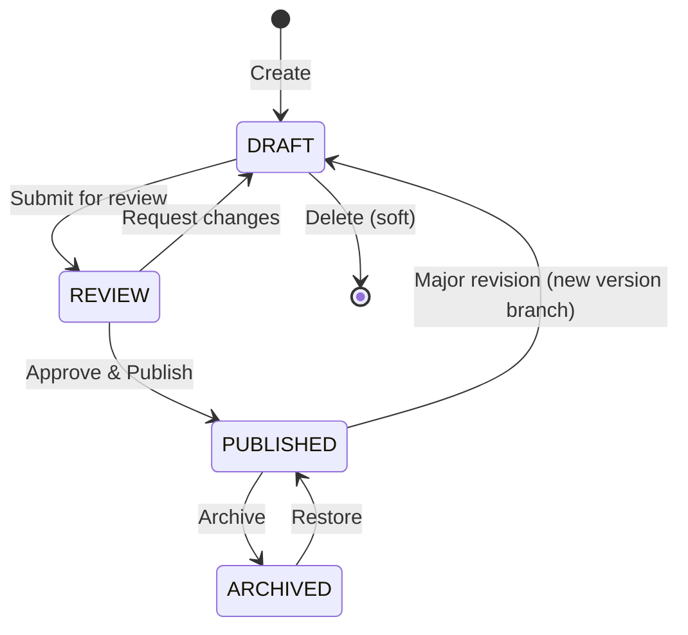

# Domain: Content

## 1. Overview

| Attribute | Value |
|-----------|-------|
| **Domain Name** | Content |
| **Bounded Context** | Learning Content Management |
| **Core Responsibility** | Theory articles, rich text content, media library, simulations |
| **Owner** | Content Domain Lead |
| **Status** | Designed |

## 2. Purpose

The Content domain manages all learning materials that students consume:
- **Theory Articles** - Structured educational content with versioning
- **Media Assets** - Images, videos, PDFs, interactive simulations
- **Tags & Categorization** - Cross-cutting organization
- **Publishing Workflow** - Draft → Review → Published → Archived

## 3. Core Entities

### 3.1 TheoryArticle

| Attribute | Type | Constraints | Description |
|-----------|------|-------------|-------------|
| `id` | BIGINT UNSIGNED | PK, AI | Primary key |
| `uuid` | CHAR(36) | NOT NULL, UNIQUE | Public identifier |
| `topic_id` | BIGINT UNSIGNED | NOT NULL, FK → topics.id | Parent topic |
| `title` | VARCHAR(200) | NOT NULL | Article title |
| `slug` | VARCHAR(220) | NOT NULL, UNIQUE(topic_id) | URL segment |
| `excerpt` | TEXT | NULLABLE | Short summary for cards/SEO |
| `status` | TINYINT UNSIGNED | NOT NULL DEFAULT 1 | 1=Draft, 2=Review, 3=Published, 4=Archived |
| `is_active` | BOOLEAN | NOT NULL DEFAULT TRUE | Visibility toggle |
| `published_at` | TIMESTAMP | NULLABLE | Publication timestamp |
| `view_count` | INT UNSIGNED | NOT NULL DEFAULT 0 | Analytics |
| `read_time_minutes` | SMALLINT UNSIGNED | NULLABLE | Auto-calculated |
| `difficulty` | TINYINT UNSIGNED | NOT NULL DEFAULT 3 | 1-5 scale |
| `meta_title` | VARCHAR(60) | NULLABLE | SEO |
| `meta_description` | VARCHAR(160) | NULLABLE | SEO |
| `canonical_url` | VARCHAR(500) | NULLABLE | SEO |
| `created_by_id` | BIGINT UNSIGNED | NULLABLE, FK → users.id | Author |
| `updated_by_id` | BIGINT UNSIGNED | NULLABLE, FK → users.id | Last editor |
| `created_at` | TIMESTAMP | NOT NULL | |
| `updated_at` | TIMESTAMP | NOT NULL | |
| `deleted_at` | TIMESTAMP | NULLABLE | Soft delete |

### 3.2 TheoryVersion (Immutable)

| Attribute | Type | Constraints | Description |
|-----------|------|-------------|-------------|
| `id` | BIGINT UNSIGNED | PK, AI | |
| `theory_article_id` | BIGINT UNSIGNED | NOT NULL, FK, CASCADE | Parent article |
| `version_number` | INT UNSIGNED | NOT NULL | Sequential (1, 2, 3...) |
| `title` | VARCHAR(200) | NOT NULL | Snapshot title |
| `content` | LONGTEXT | NOT NULL | HTML/JSON content |
| `format` | VARCHAR(20) | NOT NULL DEFAULT 'html' | 'html' or 'json' |
| `change_summary` | VARCHAR(500) | NULLABLE | What changed |
| `word_count` | INT UNSIGNED | NOT NULL DEFAULT 0 | |
| `is_published_version` | BOOLEAN | NOT NULL DEFAULT FALSE | Current live version |
| `created_by_id` | BIGINT UNSIGNED | NULLABLE, FK → users.id | |
| `created_at` | TIMESTAMP | NOT NULL | |

### 3.3 Media (spatie/laravel-medialibrary)

Uses standard `media` table. Collections configured per model:

| Model | Collection | Conversions |
|-------|------------|-------------|
| TheoryArticle | `theory_images` | thumb (300w, webp), preview (800w, webp) |
| TheoryArticle | `simulations` | original |
| Question | `question_media` | thumb (200w), webp |
| QuestionOption | `option_media` | thumb (100w), webp |
| User | `avatars` | thumb (100x100 circle), webp |
| Exam | `exam_media` | original |

### 3.4 Tag

| Attribute | Type | Constraints | Description |
|-----------|------|-------------|-------------|
| `id` | BIGINT UNSIGNED | PK, AI | |
| `uuid` | CHAR(36) | NOT NULL, UNIQUE | |
| `name` | VARCHAR(100) | NOT NULL, UNIQUE | Display name |
| `slug` | VARCHAR(120) | NOT NULL, UNIQUE | URL |
| `description` | TEXT | NULLABLE | |
| `color` | VARCHAR(7) | NOT NULL DEFAULT '#6366f1' | Hex color |
| `icon` | VARCHAR(50) | NULLABLE | Heroicon name |
| `is_system` | BOOLEAN | NOT NULL DEFAULT FALSE | Protected from deletion |
| `usage_count` | INT UNSIGNED | NOT NULL DEFAULT 0 | Denormalized |
| `created_at` | TIMESTAMP | NOT NULL | |
| `updated_at` | TIMESTAMP | NOT NULL | |

---

## 4. Relationships

```
TheoryArticle (1) ────< (N) TheoryVersion
TheoryArticle (N) ────> (1) Topic
TheoryArticle (N) ────> (N) Tag (morphToMany via taggable)
TheoryArticle (1) ────< (N) Media (morphMany)
TheoryArticle (1) ────< (N) Question (via Topic)
TheoryArticle (1) ────< (N) UserProgress (via Topic)
```

### Detailed Relationships

| Relationship | Type | Target | Cascade | Notes |
|--------------|------|--------|---------|-------|
| `topic` | BelongsTo | Topic | RESTRICT | Required parent |
| `versions` | HasMany | TheoryVersion | CASCADE | Immutable history |
| `currentVersion` | HasOne | TheoryVersion | - | Where `is_published_version = true` |
| `tags` | MorphToMany | Tag | DETACH | Via `taggable` pivot |
| `media` | MorphMany | Media | CASCADE | Spatie MediaLibrary |
| `author` | BelongsTo | User | SET NULL | `created_by_id` |
| `updater` | BelongsTo | User | SET NULL | `updated_by_id` |

---

## 5. Business Rules

### Publishing Workflow



### Publishing Rules

| Transition | Conditions | Side Effects |
|------------|------------|--------------|
| Draft → Review | Article has content, title, topic | Notifies reviewers |
| Review → Published | Approved by editor, SEO fields complete | Creates TheoryVersion (is_published_version=true), increments view_count=0, sets published_at |
| Published → Archived | None | is_active=false, archived_at=now |
| Archived → Published | None | is_active=true, archived_at=null |

### Versioning Rules

| Rule | Specification |
|------|---------------|
| **Immutability** | TheoryVersion rows are never updated after creation |
| **Auto-increment** | `version_number` = MAX + 1 per article |
| **Published Flag** | Exactly ONE version per article has `is_published_version = true` |
| **Rollback** | Creates new version copying old version's content |
| **Content Format** | TipTap HTML output; JSON stored for structured editing |

### SEO Requirements

| Field | Required For | Length |
|-------|--------------|--------|
| `meta_title` | Published | ≤ 60 chars |
| `meta_description` | Published | ≤ 160 chars |
| `canonical_url` | Published (if cross-posted) | Valid URL |
| `og:image` | Published | MediaLibrary path |

### Media Rules

| Rule | Specification |
|------|---------------|
| **Max Size** | Images: 5MB, Videos: 50MB, PDFs: 10MB |
| **Allowed Types** | Images: jpg, png, webp, gif; Videos: mp4, webm; Documents: pdf |
| **Auto-conversion** | Images → WebP (thumb 300w, preview 800w) |
| **Naming** | Stored as `{uuid}-{conversion}.{ext}` |
| **CDN** | All media served via signed S3 URLs |

---

## 6. API Contracts

### TheoryArticle Endpoints

```
GET    /api/v1/topics/{topic}/articles                    # List (filters: status, difficulty)
GET    /api/v1/articles/{uuid}                            # Show (with current version)
GET    /api/v1/articles/{uuid}/versions                   # List versions
GET    /api/v1/articles/{uuid}/versions/{version}         # Show specific version
POST   /api/v1/topics/{topic}/articles                    # Create (editor+)
PATCH  /api/v1/articles/{uuid}                            # Update draft
POST   /api/v1/articles/{uuid}/submit-review              # Submit for review
POST   /api/v1/articles/{uuid}/publish                    # Publish (creates version)
POST   /api/v1/articles/{uuid}/archive                    # Archive
POST   /api/v1/articles/{uuid}/restore                    # Restore from archive
POST   /api/v1/articles/{uuid}/rollback                   # Rollback to version
DELETE /api/v1/articles/{uuid}                            # Soft delete
```

### Media Endpoints

```
POST   /api/v1/articles/{uuid}/media                      # Upload (multipart)
DELETE /api/v1/articles/{uuid}/media/{media_id}           # Delete media
POST   /api/v1/articles/{uuid}/media/reorder              # Reorder gallery
```

### Tag Endpoints

```
GET    /api/v1/tags                                       # List (searchable)
POST   /api/v1/tags                                       # Create (admin)
PATCH  /api/v1/tags/{uuid}                                # Update
DELETE /api/v1/tags/{uuid}                                # Delete (if not system)
```

---

## 7. Filament Resources

```
Content/
├── TheoryArticleResource
│   ├── Pages: List, Create, Edit, View
│   ├── RelationManagers:
│   │   ├── VersionsRelationManager
│   │   ├── TagsRelationManager
│   │   └── MediaRelationManager
│   └── Widgets: ArticleStatsWidget
├── TagResource
│   ├── Pages: List, Create, Edit
│   └── Features: Color picker, Icon picker
└── MediaResource (Spatie MediaLibrary UI)
```

### TheoryArticle Form Schema

```php
// Main Section
Section::make('Article Content')
    ->schema([
        TextInput::make('title')->required()->maxLength(200),
        TextInput::make('slug')->required()->unique(ignoreRecord: true)->maxLength(220),
        Select::make('topic_id')
            ->relationship('topic', 'name')
            ->required()->searchable()->preload(),
        RichEditor::make('content')
            ->columnSpanFull()
            ->toolbarButtons([
                'bold', 'italic', 'underline', 'strike',
                'h1', 'h2', 'h3', 'h4',
                'bulletList', 'orderedList',
                'blockquote', 'codeBlock',
                'link', 'image', 'media',
                'table', 'horizontalRule',
                'undo', 'redo'
            ])
            ->fileAttachmentsDisk('s3')
            ->fileAttachmentsDirectory('theory-content'),
        Textarea::make('excerpt')->maxLength(500)->columnSpanFull(),
    ])->columns(2)

// Settings Section
Section::make('Settings')
    ->schema([
        Select::make('status')
            ->options(TheoryArticleStatus::options())
            ->default(TheoryArticleStatus::Draft)
            ->required(),
        Toggle::make('is_active')->default(true),
        TextInput::make('difficulty')
            ->numeric()->minValue(1)->maxValue(5)->default(3),
        TextInput::make('read_time_minutes')
            ->numeric()->label('Estimated Read Time (min)'),
    ])->columns(2)

// SEO Section (collapsible)
Section::make('SEO')->schema([
    TextInput::make('meta_title')->maxLength(60),
    Textarea::make('meta_description')->maxLength(160),
    TextInput::make('meta_keywords')->maxLength(255),
    TextInput::make('canonical_url')->url()->maxLength(500),
    FileUpload::make('og_image')
        ->image()->directory('og-images')->maxSize(2048),
])->collapsible()->collapsed()
```

---

## 8. Queries & Performance

### Common Query Patterns

```php
// Student: Published articles for a topic
TheoryArticle::query()
    ->where('topic_id', $topicId)
    ->where('status', TheoryArticleStatus::Published)
    ->where('is_active', true)
    ->with(['currentVersion', 'media'])
    ->orderBy('published_at', 'desc')
    ->paginate(10);

// Editor: My articles with status
TheoryArticle::query()
    ->where('created_by_id', auth()->id())
    ->with(['topic', 'currentVersion', 'tags'])
    ->latest('updated_at')
    ->paginate(20);

// Admin: Analytics
TheoryArticle::query()
    ->where('status', TheoryArticleStatus::Published)
    ->withCount(['media', 'tags'])
    ->withSum('userProgress as total_views', 'view_count')
    ->orderByDesc('view_count')
    ->limit(10)
    ->get();
```

### Eager Loading Standards

```php
// List view
->with(['topic', 'currentVersion', 'tags', 'media'])

// Detail view
->with([
    'topic.unit.grade',
    'currentVersion',
    'versions' => fn($q) => $q->orderByDesc('version_number')->limit(5),
    'tags',
    'media' => fn($q) => $q->where('collection_name', 'theory_images'),
    'author',
    'updater',
])
```

### Indexes

```sql
-- theory_articles
INDEX idx_articles_topic_status (topic_id, status, is_active)
INDEX idx_articles_published (published_at DESC)
INDEX idx_articles_status_active (status, is_active)
INDEX idx_articles_author (created_by_id)
FULLTEXT idx_articles_search (title, excerpt)

-- theory_versions
UNIQUE uk_versions_article_number (theory_article_id, version_number)
INDEX idx_versions_published (theory_article_id, is_published_version)
```

---

## 9. Risks & Mitigations

| Risk | Impact | Likelihood | Mitigation |
|------|--------|------------|------------|
| **Rich Text XSS** | Critical | Medium | TipTap sanitization + server-side HTML Purifier on save |
| **Version Bloat** | High | Medium | Limit to 50 versions/article; archive older to cold storage |
| **Media Orphans** | Medium | High | Daily job: delete media not attached to any model > 24h |
| **Slug Collisions** | Medium | Medium | Auto-append UUID suffix on conflict; unique per topic |
| **Concurrent Editing** | High | Medium | Optimistic locking via `version` column; last-write-wins with warning |
| **Search Performance** | High | Medium | Meilisearch index on title, excerpt, content; sync on publish |
| **Media CDN Costs** | Medium | High | Aggressive WebP conversion; signed URLs with 1h TTL |
| **Translation Sync** | Medium | Low | Separate `program_translations` pattern; content translation future work |

---

## 10. Implementation Priority

| Phase | Deliverables |
|-------|--------------|
| **Phase 1** | TheoryArticle CRUD, Versioning, TipTap editor, Basic media |
| **Phase 2** | Publishing workflow, SEO fields, Tags, Search (Meilisearch) |
| **Phase 3** | Advanced media (video, simulations), Offline sync, Analytics |
| **Phase 4** | Collaborative editing, AI-assisted content, Multi-language |

---

*End of Content Domain Design*