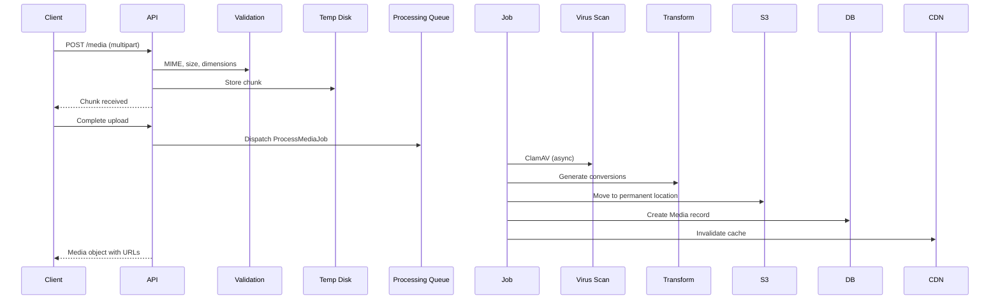

# Domain: Media

## 1. Overview

| Attribute | Value |
|-----------|-------|
| **Domain Name** | Media |
| **Bounded Context** | Digital Asset Management |
| **Core Responsibility** | File upload, storage, transformation, delivery, organization |
| **Owner** | Media Domain Lead |
| **Status** | Designed |

## 2. Purpose

The Media domain handles all file assets across the platform:
- **Theory Content** - Images, diagrams, videos, PDFs embedded in articles
- **Question Media** - Option images, question diagrams, audio for listening
- **User Assets** - Avatars, profile images
- **Exam Assets** - Exam documents, formula sheets
- **System Assets** - Logos, favicons, UI icons

## 3. Architecture

### Storage Strategy

| Layer | Technology | Purpose |
|-------|------------|---------|
| **Library** | `spatie/laravel-medialibrary` v11 | Core media handling |
| **Filesystem** | `league/flysystem-aws-s3-v3` | S3-compatible (MinIO, AWS, R2, Wasabi) |
| **Image Processing** | `intervention/image` v3 | Transformations, WebP conversion |
| **Video** | Direct S3 streaming | No transcoding (cost control) |
| **CDN** | CloudFront / Cloudflare | Global delivery, signed URLs |

### Disk Configuration

```php
// config/filesystems.php
'disks' => [
    'media' => [
        'driver' => 's3',
        'key' => env('MEDIA_AWS_KEY'),
        'secret' => env('MEDIA_AWS_SECRET'),
        'region' => env('MEDIA_AWS_REGION', 'us-east-1'),
        'bucket' => env('MEDIA_AWS_BUCKET'),
        'url' => env('MEDIA_CDN_URL'), // CDN domain
        'endpoint' => env('MEDIA_AWS_ENDPOINT'), // For MinIO
        'visibility' => 'private',
        'throw' => false,
    ],
    'media_temp' => [
        'driver' => 'local',
        'root' => storage_path('app/temp/media'),
    ],
],
```

---

## 4. Collections & Models

### 4.1 Collection Registry

| Model | Collection | Accepted MIME | Max Size | Conversions |
|-------|------------|---------------|----------|-------------|
| `TheoryArticle` | `theory_images` | image/jpeg, image/png, image/webp | 5 MB | thumb (300w), preview (800w), webp |
| `TheoryArticle` | `simulations` | application/javascript, application/json | 10 MB | - |
| `Question` | `question_media` | image/*, video/mp4, audio/mpeg | 3 MB | thumb (200w), webp |
| `QuestionOption` | `option_media` | image/* | 1 MB | thumb (100w), webp |
| `User` | `avatars` | image/jpeg, image/png, image/webp | 2 MB | thumb (100x100 circle), webp |
| `Exam` | `exam_media` | application/pdf, image/* | 10 MB | thumb (200w) |
| `TheoryArticle` | `attachments` | application/pdf, application/msword | 20 MB | - |

### 4.2 Collection Configuration (Per Model)

```php
// TheoryArticle.php
public function registerMediaCollections(): void
{
    $this->addMediaCollection('theory_images')
        ->acceptsMimeTypes(['image/jpeg', 'image/png', 'image/webp', 'image/gif'])
        ->maxFileSize(5 * 1024 * 1024)
        ->singleFile()
        ->registerMediaConversions(function (Media $media) {
            $this->addMediaConversion('thumb')
                ->width(300)
                ->format('webp')
                ->quality(80)
                ->nonQueued();
            $this->addMediaConversion('preview')
                ->width(800)
                ->format('webp')
                ->quality(85)
                ->nonQueued();
        });

    $this->addMediaCollection('simulations')
        ->acceptsMimeTypes(['application/javascript', 'application/json', 'text/html'])
        ->maxFileSize(10 * 1024 * 1024)
        ->singleFile();

    $this->addMediaCollection('attachments')
        ->acceptsMimeTypes(['application/pdf', 'application/msword', 'application/vnd.openxmlformats-officedocument.wordprocessingml.document'])
        ->maxFileSize(20 * 1024 * 1024);
}

// Question.php
public function registerMediaCollections(): void
{
    $this->addMediaCollection('question_media')
        ->acceptsMimeTypes(['image/jpeg', 'image/png', 'image/webp', 'video/mp4', 'audio/mpeg'])
        ->maxFileSize(3 * 1024 * 1024)
        ->registerMediaConversions(function (Media $media) {
            if (Str::startsWith($media->mime_type, 'image/')) {
                $this->addMediaConversion('thumb')
                    ->width(200)
                    ->format('webp')
                    ->quality(80);
            }
        });

    $this->addMediaCollection('explanations')
        ->acceptsMimeTypes(['image/jpeg', 'image/png', 'image/webp', 'video/mp4'])
        ->maxFileSize(5 * 1024 * 1024);
}
```

---

## 4.3 Custom Properties

| Property | Type | Description |
|----------|------|-------------|
| `alt` | string | Alt text for accessibility |
| `caption` | string | Caption for galleries |
| `credit` | string | Source attribution |
| `license` | string | License identifier (CC-BY, CC0, proprietary) |
| `width` | int | Original width (px) |
| `height` | int | Original height (px) |
| `duration` | float | Video/audio duration (seconds) |
| `is_featured` | bool | Featured in article/list |
| `sort_order` | int | Gallery ordering |

---

## 5. Upload & Processing Pipeline

### 5.1 Upload Flow



### 5.2 Validation Rules

```php
class MediaUploadRequest extends FormRequest
{
    public function rules(): array
    {
        $collection = $this->route('collection');
        $config = config("media.collections.{$collection}");
        
        return [
            'file' => [
                'required',
                'file',
                'max:' . ($config['max_size_kb'] ?? 5120),
                'mimes:' . implode(',', $config['mime_extensions'] ?? ['jpg', 'png', 'webp']),
                'dimensions:' . $this->dimensionRules($config),
            ],
            'alt' => ['nullable', 'string', 'max:255'],
            'caption' => ['nullable', 'string', 'max:500'],
            'is_featured' => ['boolean'],
        ];
    }
    
    private function dimensionRules(array $config): string
    {
        return implode(',', [
            'min_width:' . ($config['min_width'] ?? 100),
            'max_width:' . ($config['max_width'] ?? 4000),
            'min_height:' . ($config['min_height'] ?? 100),
            'max_height:' . ($config['max_height'] ?? 4000),
            'ratio:' . ($config['ratio'] ?? '1/1,16/9,4/3,3/4'),
        ]);
    }
}
```

### 5.3 Conversion Pipeline

```php
// config/media-library.php
'conversions' => [
    'thumb' => [
        'width' => 300,
        'height' => null,
        'format' => 'webp',
        'quality' => 80,
        'fit' => 'contain',
    ],
    'preview' => [
        'width' => 800,
        'height' => null,
        'format' => 'webp',
        'quality' => 85,
        'fit' => 'contain',
    ],
    'circle' => [
        'width' => 100,
        'height' => 100,
        'format' => 'webp',
        'quality' => 80,
        'fit' => 'crop',
        'crop_position' => 'center',
    ],
    'og_image' => [
        'width' => 1200,
        'height' => 630,
        'format' => 'webp',
        'quality' => 90,
        'fit' => 'crop',
    ],
],

'conversion_queues' => [
    'default' => 'media-conversions',
    'thumb' => 'media-conversions-high-priority',
],
```

---

## 5. Delivery & URLs

### 5.1 URL Structure

| Type | Format | Example |
|------|--------|---------|
| Original | `/{disk}/{model_type}/{id}/{uuid}.{ext}` | `/media/theory-articles/1/abc123.webp` |
| Conversion | `/{disk}/conversions/{model_type}/{id}/{conversion}/{uuid}.webp` | `/media/conversions/theory-articles/1/thumb/abc123.webp` |
| CDN | `https://cdn.kimyaogren.com/{path}` | `https://cdn.kimyaogren.com/media/...` |
| Signed URL | `/{path}?token={jwt}&expires={timestamp}` | For private media |

### 5.2 Signed URL Generation

```php
class MediaUrlService
{
    public function getSignedUrl(Media $media, string $conversion = '', int $ttlMinutes = 60): string
    {
        $path = $conversion 
            ? $media->getPath($conversion) 
            : $media->getPath();
        
        $payload = [
            'path' => $path,
            'exp' => now()->addMinutes($ttlMinutes)->timestamp,
            'sub' => auth()->id(),
        ];
        
        $token = JWT::encode($payload, config('app.key'), 'HS256');
        
        return config('media.cdn_url') . "/{$path}?token={$token}";
    }
    
    public function getPublicUrl(Media $media, string $conversion = ''): string
    {
        return $media->getUrl($conversion ?: '');
    }
}
```

### 5.3 Responsive Image Helper

```blade
{{-- Blade component --}}
<x-media-image 
    :media="$article->getFirstMedia('theory_images')" 
    alt="{{$article->title}}"
    conversions="thumb,preview"
    loading="lazy"
    class="w-full rounded-lg"
/>

{{-- Generates --}}
<picture>
    <source type="image/webp" srcset="
        https://cdn.example.com/.../thumb/abc.webp 300w,
        https://cdn.example.com/.../preview/abc.webp 800w
    " sizes="(max-width: 768px) 100vw, 50vw">
    
</picture>
```

---

## 6. Media Management UI (Filament)

```php
// MediaResource (using spatie/filament-medialibrary-plugin)
MediaResource::make()
    ->collection('theory_images')
    ->columns([
        Tables\Columns\ImageColumn::make('thumbnail')
            ->conversion('thumb')
            ->circular(),
        Tables\Columns\TextColumn::make('name')
            ->searchable()
            ->limit(30),
        Tables\Columns\TextColumn::make('mime_type')
            ->badge()
            ->color(fn ($state) => match(true) {
                Str::startsWith($state, 'image/') => 'success',
                Str::startsWith($state, 'video/') => 'warning',
                default => 'gray',
            }),
        Tables\Columns\TextColumn::make('size')
            ->formatStateUsing(fn ($state) => Number::format($state / 1024) . ' KB'),
        Tables\Columns\TextColumn::make('created_at')
            ->dateTime('d.m.Y H:i')
            ->sortable(),
    ])
    ->filters([
        Tables\Filters\SelectFilter::make('collection_name')
            ->options(config('media.collections')),
        Tables\Filters\Filter::make('orphaned')
            ->query(fn ($query) => $query->whereNull('model_id')),
    ])
    ->actions([
        Tables\Actions\Action::make('download')
            ->url(fn (Media $record) => $record->getUrl())
            ->icon('heroicon-o-arrow-down-tray'),
        Tables\Actions\DeleteAction::make(),
    ])
    ->bulkActions([
        Tables\Actions\DeleteBulkAction::make(),
    ]);
```

---

## 6. Cleanup & Maintenance Jobs

| Job | Schedule | Description |
|-----|----------|-------------|
| `CleanupOrphanedMedia` | Daily 02:00 | Delete media with no model after 24h |
| `RegenerateConversions` | On demand | Re-process failed conversions |
| `OptimizeImages` | Weekly | Re-compress with newer WebP encoder |
| `MigrateToNewCdn` | One-time | Bulk URL rewrite during migration |
| `AuditMediaUsage` | Monthly | Report unused/orphaned media |

---

## 7. Risks & Mitigations

| Risk | Impact | Mitigation |
|------|--------|------------|
| **S3 Cost Explosion** | High | Lifecycle rules: move >90d to Glacier; aggressive WebP; max size limits |
| **Upload Abuse** | High | Signed upload URLs; per-user quotas; MIME validation; dimension limits |
| **CDN Cache Poisoning** | Medium | Signed URLs for private; cache keys include version hash |
| **Conversion Failures** | Medium | Queue retries (3x); dead letter queue; alert on failure rate > 5% |
| **Copyright Infringement** | Legal | Alt text required; license field; DMCA takedown process |
| **Broken References** | Medium | Soft delete media; cascade on model delete; orphan cleanup job |
| **Video Bandwidth** | High | No transcoding; direct S3 streaming; max 50MB; consider Mux future |

---

*End of Media Domain Design*