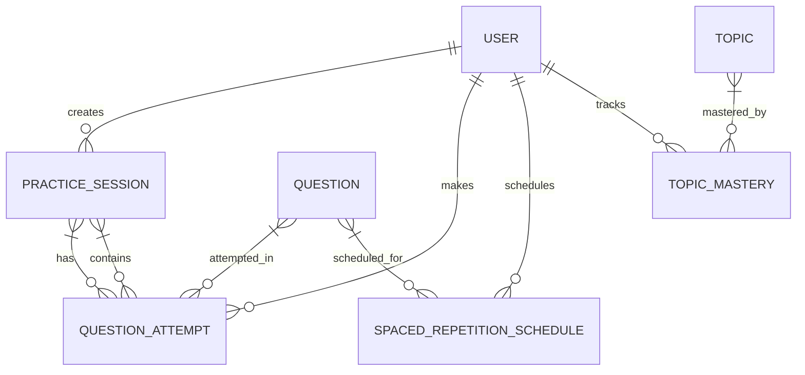

# Domain: Practice

## 1. Overview

| Attribute | Value |
|-----------|-------|
| **Domain Name** | Practice |
| **Bounded Context** | Student Practice, Spaced Repetition, Mastery Tracking |
| **Core Responsibility** | Practice sessions, SM-2 scheduling, mastery calculation, due queue |
| **Owner** | Practice Domain Lead |
| **Status** | Designed |

## 2. Purpose

The Practice domain manages how students engage with questions outside of formal exams:
- **Practice Sessions** - Topic-focused, mixed review, weak areas, timed, exam simulation
- **Spaced Repetition (SM-2)** - Per-question scheduling, quality grading, intervals
- **Mastery Tracking** - Per-topic mastery percentage, levels, trends
- **Due Queue** - Questions due for review, prioritization

## 3. Core Entities

### 3.1 PracticeSession

| Attribute | Type | Constraints | Description |
|-----------|------|-------------|-------------|
| `id` | BIGINT UNSIGNED | PK, AI | |
| `uuid` | CHAR(36) | NOT NULL, UNIQUE | |
| `user_id` | BIGINT UNSIGNED | NOT NULL, FK → users.id, CASCADE | Student |
| `topic_id` | BIGINT UNSIGNED | NULLABLE, FK → topics.id, SET NULL | Null for mixed/timed/exam |
| `type` | VARCHAR(30) | NOT NULL | Enum: `topic`, `mixed_review`, `weak_areas`, `timed_quiz`, `exam_simulation` |
| `started_at` | TIMESTAMP | NOT NULL | Session start |
| `completed_at` | TIMESTAMP | NULLABLE | |
| `time_limit_seconds` | INT UNSIGNED | NULLABLE | For timed_quiz/exam_simulation |
| `question_count` | SMALLINT UNSIGNED | NOT NULL DEFAULT 0 | Total questions |
| `correct_count` | SMALLINT UNSIGNED | NOT NULL DEFAULT 0 | |
| `skipped_count` | SMALLINT UNSIGNED | NOT NULL DEFAULT 0 | |
| `score` | DECIMAL(5,2) | NULLABLE | Percentage |
| `session_data` | JSON | NULLABLE | Config: filters, question IDs |
| `created_at` | TIMESTAMP | NOT NULL | |
| `updated_at` | TIMESTAMP | NOT NULL | |

### 3.2 QuestionAttempt (Shared with Assessment)

| Attribute | Type | Constraints | Description |
|-----------|------|-------------|-------------|
| `id` | BIGINT UNSIGNED | PK, AI | |
| `user_id` | BIGINT UNSIGNED | NOT NULL, FK → users.id, CASCADE | Student |
| `question_id` | BIGINT UNSIGNED | NOT NULL, FK → questions.id, RESTRICT | |
| `practice_session_id` | BIGINT UNSIGNED | NULLABLE, FK → practice_sessions.id, SET NULL | |
| `exam_attempt_id` | BIGINT UNSIGNED | NULLABLE, FK → exam_attempts.id, SET NULL | |
| `selected_option_id` | BIGINT UNSIGNED | NULLABLE, FK → question_options.id, SET NULL | |
| `answer_text` | TEXT | NULLABLE | Short answer/essay |
| `is_correct` | BOOLEAN | NOT NULL | |
| `quality` | TINYINT UNSIGNED | NULLABLE | SM-2 quality 0-5 |
| `time_spent_seconds` | SMALLINT UNSIGNED | NULLABLE | |
| `attempt_number` | SMALLINT UNSIGNED | NOT NULL DEFAULT 1 | Retry count |
| `points_earned` | DECIMAL(5,2) | NULLABLE | Weighted scoring |
| `metadata` | JSON | NULLABLE | Hints, partial credit |
| `answered_at` | TIMESTAMP | NOT NULL | |

### 3.3 SpacedRepetitionSchedule (Per Question)

| Attribute | Type | Constraints | Description |
|-----------|------|-------------|-------------|
| `id` | BIGINT UNSIGNED | PK, AI | |
| `user_id` | BIGINT UNSIGNED | NOT NULL, FK → users.id, CASCADE | |
| `question_id` | BIGINT UNSIGNED | NOT NULL, FK → questions.id, CASCADE | |
| `ease_factor` | DECIMAL(4,2) | NOT NULL DEFAULT 2.50 | SM-2 EF (1.3-2.5) |
| `interval_days` | SMALLINT UNSIGNED | NOT NULL DEFAULT 0 | Days until next review |
| `repetitions` | SMALLINT UNSIGNED | NOT NULL DEFAULT 0 | Consecutive correct |
| `next_review_at` | TIMESTAMP | NOT NULL | Next scheduled |
| `last_reviewed_at` | TIMESTAMP | NULLABLE | |
| `last_quality` | TINYINT UNSIGNED | NULLABLE | Last answer quality 0-5 |
| `is_suspended` | BOOLEAN | NOT NULL DEFAULT FALSE | Pause scheduling |
| `is_due` | BOOLEAN | NOT NULL DEFAULT FALSE | Computed flag |
| `created_at` | TIMESTAMP | NOT NULL | |
| `updated_at` | TIMESTAMP | NOT NULL | |

### 3.4 TopicMastery (Per Topic)

| Attribute | Type | Constraints | Description |
|-----------|------|-------------|-------------|
| `id` | BIGINT UNSIGNED | PK, AI | |
| `user_id` | BIGINT UNSIGNED | NOT NULL, FK → users.id, CASCADE | |
| `topic_id` | BIGINT UNSIGNED | NOT NULL, FK → topics.id, CASCADE | |
| `mastery_percentage` | DECIMAL(5,2) | NOT NULL DEFAULT 0.00 | 0-100 |
| `mastery_level` | TINYINT UNSIGNED | NOT NULL DEFAULT 0 | 0=Novice, 1=Learning, 2=Proficient, 3=Mastered |
| `total_attempts` | INT UNSIGNED | NOT NULL DEFAULT 0 | Lifetime |
| `correct_attempts` | INT UNSIGNED | NOT NULL DEFAULT 0 | Lifetime |
| `last_practiced_at` | TIMESTAMP | NULLABLE | |
| `next_review_at` | TIMESTAMP | NULLABLE | Topic-level due |
| `ease_factor` | DECIMAL(4,2) | NOT NULL DEFAULT 2.50 | Topic EF |
| `interval_days` | SMALLINT UNSIGNED | NOT NULL DEFAULT 0 | |
| `repetitions` | SMALLINT UNSIGNED | NOT NULL DEFAULT 0 | |
| `is_due` | BOOLEAN | NOT NULL DEFAULT FALSE | |
| `created_at` | TIMESTAMP | NOT NULL | |
| `updated_at` | TIMESTAMP | NOT NULL | |

---

## 4. Relationships



### Detailed

| Entity | Relationship | Target | Cascade |
|--------|--------------|--------|---------|
| PracticeSession | BelongsTo | User | CASCADE |
| PracticeSession | BelongsTo | Topic | SET NULL |
| PracticeSession | HasMany | QuestionAttempt | CASCADE |
| QuestionAttempt | BelongsTo | User | CASCADE |
| QuestionAttempt | BelongsTo | Question | RESTRICT |
| QuestionAttempt | BelongsTo | PracticeSession | SET NULL |
| QuestionAttempt | BelongsTo | ExamAttempt | SET NULL |
| QuestionAttempt | BelongsTo | QuestionOption | SET NULL |
| SpacedRepetitionSchedule | BelongsTo | User | CASCADE |
| SpacedRepetitionSchedule | BelongsTo | Question | CASCADE |
| TopicMastery | BelongsTo | User | CASCADE |
| TopicMastery | BelongsTo | Topic | CASCADE |

---

## 5. Session Types

| Type | Code | Description | Question Source | Timer |
|------|------|-------------|-----------------|-------|
| **Topic Practice** | `topic` | Single topic focused | Single topic | None |
| **Mixed Review** | `mixed_review` | Spaced repetition due queue | Due questions across topics | Optional |
| **Weak Areas** | `weak_areas` | Topics with mastery < 60% | Low mastery topics | Optional |
| **Timed Quiz** | `timed_quiz` | Fixed time, random questions | Filtered pool | Fixed |
| **Exam Simulation** | `exam_simulation` | Full YKS format | Official distribution | 80 min |

### Session Configuration (session_data JSON)

```json
{
  "topic_practice": {
    "topic_id": 42,
    "question_count": 15,
    "difficulty_range": [2, 4],
    "bloom_levels": [2, 3, 4]
  },
  "mixed_review": {
    "max_questions": 20,
    "topic_weights": { "42": 0.3, "43": 0.2, "44": 0.5 },
    "include_new": true
  },
  "weak_areas": {
    "mastery_threshold": 60,
    "max_questions": 25,
    "focus_topics": [42, 43]
  },
  "timed_quiz": {
    "duration_seconds": 900,
    "question_count": 20,
    "topic_ids": [42, 43, 44]
  },
  "exam_simulation": {
    "exam_id": 5,
    "time_limit_seconds": 4800
  }
}
```

---

## 6. Spaced Repetition (SM-2) Algorithm

### Parameters

| Parameter | Default | Range | Description |
|-----------|---------|---------|-------------|
| `initial_ease_factor` | 2.50 | 1.30 - 2.50 | Starting EF |
| `min_ease_factor` | 1.30 | - | Floor |
| `max_ease_factor` | 2.50 | - | Ceiling |
| `initial_interval` | 1 day | - | First review |
| `second_interval` | 6 days | - | After 1st success |
| `max_interval` | 365 days | - | Cap |
| `lapse_reset_interval` | 1 day | - | After failure |

### Quality Scale (0-5)

| Quality | Description | Result |
|---------|-------------|--------|
| 5 | Perfect, instant recall | EF += 0.15, interval × EF |
| 4 | Correct, slight hesitation | EF += 0.10, interval × EF |
| 3 | Correct, significant difficulty | EF unchanged, interval × EF |
| 2 | Incorrect, but recognized answer | EF -= 0.15, interval = 1 |
| 1 | Incorrect, familiar but wrong | EF -= 0.20, interval = 1 |
| 0 | Complete blackout | EF -= 0.25, interval = 1 |

### SM-2 Implementation

```php
class SpacedRepetitionService
{
    public function processReview(
        SpacedRepetitionSchedule $schedule,
        int $quality  // 0-5
    ): void {
        $ef = max(1.30, $schedule->ease_factor + (0.1 - (5 - $quality) * (0.08 + (5 - $quality) * 0.02)));
        
        if ($quality < 3) {
            // Failed review - reset
            $schedule->repetitions = 0;
            $schedule->interval_days = 1;
        } else {
            // Successful review
            if ($schedule->repetitions === 0) {
                $schedule->interval_days = 1;
            } elseif ($schedule->repetitions === 1) {
                $schedule->interval_days = 6;
            } else {
                $schedule->interval_days = (int) round($schedule->interval_days * $ef);
            }
            $schedule->repetitions++;
        }
        
        $schedule->ease_factor = min(2.50, $ef);
        $schedule->interval_days = min(365, $schedule->interval_days);
        $schedule->last_reviewed_at = now();
        $schedule->next_review_at = now()->addDays($schedule->interval_days);
        $schedule->last_quality = $quality;
        $schedule->is_due = $schedule->next_review_at->lte(now());
        $schedule->save();
        
        // Update TopicMastery
        $this->updateTopicMastery($schedule->user_id, $schedule->question->topic_id);
    }
}
```

### Due Queue Prioritization

```sql
-- Priority order for mixed_review sessions
SELECT q.*
FROM spaced_repetition_schedules srs
JOIN questions q ON q.id = srs.question_id
WHERE srs.user_id = ?
  AND srs.is_suspended = false
  AND srs.is_due = true
ORDER BY 
    srs.next_review_at ASC,                    -- Most overdue first
    srs.repetitions ASC,                        -- Newer cards first
    srs.ease_factor ASC,                        -- Harder cards first
    RAND()                                      -- Tiebreaker
LIMIT 20;
```

---

## 7. Mastery Calculation

### Per-Question Mastery

```php
function calculateQuestionMastery(
    Collection $attempts,
    int $recentWeight = 70  // % weight to recent attempts
): float {
    if ($attempts->isEmpty()) return 0.0;
    
    // Sort by date descending
    $attempts = $attempts->sortByDesc('answered_at');
    
    // Exponential decay weighting
    $totalWeight = 0;
    $weightedSum = 0;
    
    foreach ($attempts as $index => $attempt) {
        $weight = pow(0.85, $index);  // Decay factor
        $correct = $attempt->is_correct ? 1.0 : 0.0;
        
        $weightedSum += $correct * $weight;
        $totalWeight += $weight;
    }
    
    return round(($weightedSum / $totalWeight) * 100, 1);
}
```

### Topic Mastery Levels

| Level | Range | Label | Description |
|-------|-------|-------|-------------|
| 0 | 0-29% | Novice | New or struggling |
| 1 | 30-59% | Learning | Progressing |
| 2 | 60-79% | Proficient | Solid understanding |
| 3 | 80-100% | Mastered | Ready for advanced |

### Topic Mastery Update Trigger

```php
function updateTopicMastery(int $userId, int $topicId): void
{
    $questions = Question::where('topic_id', $topicId)->pluck('id');
    $attempts = QuestionAttempt::where('user_id', $userId)
        ->whereIn('question_id', $questions)
        ->get();
    
    $masteryPct = calculateQuestionMastery($attempts);
    $level = match (true) {
        $masteryPct >= 80 => 3,
        $masteryPct >= 60 => 2,
        $masteryPct >= 30 => 1,
        default => 0,
    };
    
    TopicMastery::updateOrCreate(
        ['user_id' => $userId, 'topic_id' => $topicId],
        [
            'mastery_percentage' => $masteryPct,
            'mastery_level' => $level,
            'total_attempts' => $attempts->count(),
            'correct_attempts' => $attempts->where('is_correct', true)->count(),
            'last_practiced_at' => $attempts->max('answered_at'),
            'is_due' => $masteryPct < 60,  // Due if not proficient
        ]
    );
}
```

---

## 8. Session Generation Logic

### Question Selection Strategy

| Session Type | Algorithm |
|--------------|-----------|
| **Topic Practice** | Random from topic, weighted by difficulty range |
| **Mixed Review** | Priority: overdue SRS > weak areas > new questions |
| **Weak Areas** | Topics with mastery < 60%, weighted by gap |
| **Timed Quiz** | Random from pool, balanced difficulty distribution |
| **Exam Simulation** | Fixed distribution matching official YKS spec |

### Mixed Review Priority Formula

```php
function getMixedReviewQuestions(int $userId, int $limit = 20): Collection
{
    // 1. Overdue SRS questions (highest priority)
    $overdue = SpacedRepetitionSchedule::query()
        ->where('user_id', $userId)
        ->where('is_due', true)
        ->where('is_suspended', false)
        ->with('question.topic')
        ->orderBy('next_review_at')
        ->limit($limit)
        ->get()
        ->pluck('question_id');
    
    if ($overdue->count() >= $limit) {
        return Question::whereIn('id', $overdue)->get();
    }
    
    // 2. Weak area questions (mastery < 60%)
    $weakTopics = TopicMastery::query()
        ->where('user_id', $userId)
        ->where('mastery_percentage', '<', 60)
        ->where('is_due', true)
        ->pluck('topic_id');
    
    $weakQuestions = Question::query()
        ->whereIn('topic_id', $weakTopics)
        ->where('status', QuestionStatus::Approved)
        ->where('is_active', true)
        ->whereNotIn('id', $overdue)
        ->inRandomOrder()
        ->limit($limit - $overdue->count())
        ->get();
    
    return $overdue->concat($weakQuestions->pluck('id'));
}
```

---

## 9. API Contracts

```
GET    /api/v1/practice/sessions                    # List with filters
POST   /api/v1/practice/sessions                    # Start session
GET    /api/v1/practice/sessions/{uuid}             # Get session state
POST   /api/v1/practice/sessions/{uuid}/answer      # Submit answer
POST   /api/v1/practice/sessions/{uuid}/complete    # End session
GET    /api/v1/practice/due-queue                   # Questions due
GET    /api/v1/practice/mastery                     # Topic mastery list
GET    /api/v1/practice/mastery/{topic}             # Topic mastery detail
GET    /api/v1/practice/stats                       # User practice stats
GET    /api/v1/practice/stats/topic/{topic}         # Topic stats
```

### Session Answer Payload

```json
POST /api/v1/practice/sessions/{uuid}/answer
{
  "question_id": 105,
  "selected_option_id": 420,
  "answer_text": null,
  "time_spent_seconds": 15,
  "confidence": 4
}
```

### Session Complete Response

```json
{
  "session": {
    "id": "uuid",
    "score": 78.5,
    "correct_count": 12,
    "total_count": 15,
    "time_spent_seconds": 420
  },
  "results": [
    {
      "question_id": 105,
      "is_correct": true,
      "quality": 5,
      "explanation": "Bohr model postulates...",
      "next_review_in_days": 3
    }
  ],
  "mastery_updates": [
    { "topic_id": 42, "mastery_percentage": 72.5, "level": 2, "is_due": false }
  ]
}
```

---

## 10. Filament Resources

```
Practice/
├── PracticeSessionResource (read-only)
│   ├── Pages: List, View
│   └── Widgets: SessionAnalyticsWidget
├── TopicMasteryResource
│   ├── Pages: List, View
│   └── Filters: level, due, topic
└── SpacedRepetitionScheduleResource (admin)
    ├── Pages: List, View
    └── Actions: Suspend/Resume, Reset
```

---

## 10. Risks & Mitigations

| Risk | Impact | Mitigation |
|------|--------|------------|
| **SRS Drift** | High | Daily job recalculates `is_due`; admin can trigger recalculation |
| **Mastery Inflation** | High | Decay weighting; minimum attempts required for level up |
| **Queue Starvation** | Medium | Minimum 5 new cards/day; topic diversity enforcement |
| **Algorithm Tuning** | High | A/B test EF parameters; configurable per program |
| **Data Volume** | Medium | Partition `question_attempts` by month; archive old sessions |
| **Concurrency** | Medium | Optimistic locking on `SpacedRepetitionSchedule` |

---

*End of Practice Domain Design*