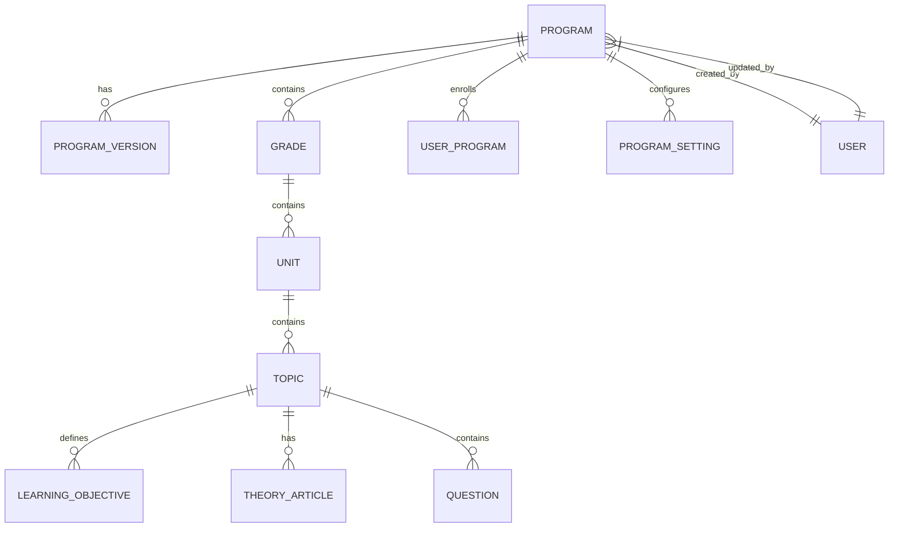
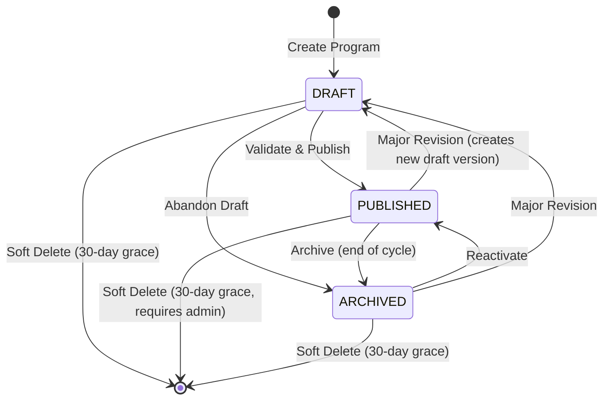

# Program Domain Design

## 1. Domain Analysis

### What is a Program?

A **Program** is the highest-level container in the KimyaÖğren academic hierarchy. It represents a complete, structured educational curriculum for a specific subject area (e.g., "High School Chemistry", "Middle School Physics"). A Program defines the overall scope, target audience, and organizational framework for all downstream content.

### Why Does It Exist?

- **Curriculum Organization**: Groups related Units into a coherent learning pathway
- **Multi-Curriculum Support**: Enables multiple programs (e.g., "Turkish National Chemistry", "IB Chemistry", "AP Chemistry") to coexist
- **Access Control**: Determines which users (by role, grade, school) can access which content
- **Reporting Scope**: Provides top-level aggregation for analytics (completion rates, mastery across entire program)
- **Versioning Anchor**: Curriculum updates happen at Program level (e.g., "2024-2025 Chemistry Program")

### Business Purpose

| Purpose | Description |
|---------|-------------|
| **Hierarchy Root** | Every Unit, Topic, Learning Objective, and Question belongs to exactly one Program |
| **Curriculum Versioning** | Programs are versioned (e.g., "Chemistry 2024", "Chemistry 2025") for annual MEB updates |
| **Localization Anchor** | Programs can have language-specific variants (Turkish, English) |
| **Tenant Isolation** | Future multi-school support: each school/organization maps to a Program instance |
| **Reporting Boundary** | Analytics roll up to Program level for administrators |

### System Relationship

```
Program (Root)
    │
    ├── Grades (9, 10, 11, 12)
    │       │
    │       └── Units
    │               │
    │               └── Topics
    │                       │
    │                       ├── Learning Objectives
    │                       ├── Theory Articles
    │                       ├── Questions
    │                       └── Practice Sessions
    │
    ├── Users (Students/Teachers enrolled in Program)
    │
    ├── Settings (Program-specific: grading, pacing, features)
    │
    └── Versions (Program version history)
```

---

## 2. Business Rules

### Identity & Uniqueness
| Rule | Specification |
|------|---------------|
| **Unique Name** | Program `name` must be unique system-wide (e.g., only one "High School Chemistry") |
| **Unique Code** | Program `code` must be unique (e.g., `HS_CHEM_TR`, `IB_CHEM_EN`) |
| **Unique Slug** | Program `slug` must be unique for public URLs |

### Lifecycle & Status
| Rule | Specification |
|------|---------------|
| **Draft → Published** | Only validated, complete Programs can be published |
| **Published → Archived** | Allowed at any time; preserves data for historical reporting |
| **Archived → Published** | Allowed (re-activation) |
| **Draft → Archived** | Allowed (abandon draft) |
| **Deleted** | Soft delete only; hard delete requires admin + 30-day grace period |
| **Inactive** | `is_active = false` hides from student UI but retains admin access |

### Structure & Ordering
| Rule | Specification |
|------|---------------|
| **Display Order** | `display_order` determines Program listing order (admin + public) |
| **Reordering** | Admins can change order at any time; affects UI immediately |
| **Grade Range** | Program defines `min_grade` and `max_grade` (e.g., 9-12) |

### Localization & SEO
| Rule | Specification |
|------|---------------|
| **Primary Language** | Every Program has a `primary_language` (default: `tr`) |
| **Translations** | Name, description, SEO fields support per-language overrides |
| **Slug Uniqueness** | Slug unique per language (e.g., `/tr/kimya`, `/en/chemistry`) |
| **SEO Required** | Published Programs must have `meta_title` and `meta_description` |

### Access & Permissions
| Rule | Specification |
|------|---------------|
| **Student Access** | Students see only Published, Active Programs matching their grade |
| **Teacher Access** | Teachers see Programs for their assigned classes |
| **Admin Access** | Full CRUD on all Programs regardless of status |
| **Content Editor** | Can edit Draft/Published Programs in assigned subjects |

### Versioning

> **Status: Deferred to a future Epic** — see `## 5. Lifecycle` below and ADR-003. Not implemented in Epic 1.

| Rule | Specification |
|------|---------------|
| **Immutable Versions** | Published Programs are snapshotted as immutable versions |
| **Current Version** | One `current_version` pointer per Program |
| **Rollback** | Admins can rollback to previous version (creates new version) |

---

## 3. Entity Definition

### Core Attributes

| Attribute | Type | Nullable | Default | Validation | Purpose |
|-----------|------|----------|---------|------------|---------|
| `id` | BIGINT UNSIGNED | NO | AUTO_INCREMENT | PK | Primary key |
| `uuid` | CHAR(36) | NO | UUIDv4 | Unique, Index | Public identifier (API, URLs) |
| `code` | VARCHAR(30) | NO | — | Unique, AlphaNum + `_` | Machine-readable code (e.g., `HS_CHEM_TR`) |
| `name` | VARCHAR(150) | NO | — | Unique, 3-150 chars | Display name (e.g., "High School Chemistry") |
| `slug` | VARCHAR(180) | NO | — | Unique, alpha-dash | Public URL segment |
| `description` | TEXT | YES | NULL | Max 5000 chars | Detailed description for admins |
| `short_description` | VARCHAR(500) | YES | NULL | Max 500 chars | Card/list preview text |
| `primary_language` | CHAR(5) | NO | `tr` | ISO 639-1 + region (e.g., `tr`, `en-US`) | Default content language |
| `supported_languages` | JSON | NO | `["tr"]` | Array of locale codes | Available translations |
| `min_grade` | TINYINT UNSIGNED | NO | 9 | 1-12 | Minimum grade level |
| `max_grade` | TINYINT UNSIGNED | NO | 12 | 1-12, ≥ min_grade | Maximum grade level |
| `status` | TINYINT UNSIGNED | NO | 1 (Draft) | Enum: 1=Draft, 2=Published, 3=Archived | Lifecycle state |
| `is_active` | BOOLEAN | NO | TRUE | — | Visibility toggle |
| `display_order` | SMALLINT UNSIGNED | NO | 0 | ≥ 0 | UI sorting |
| `version` | INT UNSIGNED | NO | 1 | ≥ 1, increments on publish | Current version number |
| `current_version_id` | BIGINT UNSIGNED | YES | NULL | FK → program_versions.id | Pointer to current snapshot |
| `meta_title` | VARCHAR(60) | YES | NULL | Max 60 chars | SEO title |
| `meta_description` | VARCHAR(160) | YES | NULL | Max 160 chars | SEO description |
| `meta_keywords` | VARCHAR(255) | YES | NULL | Comma-separated | SEO keywords |
| `og_image_path` | VARCHAR(500) | YES | NULL | Valid media path | Open Graph image |
| `settings` | JSON | NO | `{}` | Validated schema | Program-specific config |
| `created_by_id` | BIGINT UNSIGNED | YES | NULL | FK → users.id, SET NULL | Creator |
| `updated_by_id` | BIGINT UNSIGNED | YES | NULL | FK → users.id, SET NULL | Last editor |
| `published_at` | TIMESTAMP | YES | NULL | — | Publication timestamp |
| `archived_at` | TIMESTAMP | YES | NULL | — | Archive timestamp |
| `created_at` | TIMESTAMP | NO | NOW() | — | Creation time |
| `updated_at` | TIMESTAMP | NO | NOW() | — | Last update |
| `deleted_at` | TIMESTAMP | YES | NULL | — | Soft delete |

### Settings JSON Schema

```json
{
  "pacing": {
    "weeks_per_unit": 4,
    "allow_self_paced": true,
    "enforce_sequential": false
  },
  "assessment": {
    "passing_score": 70,
    "allow_retakes": true,
    "max_retakes": 3
  },
  "features": {
    "spaced_repetition": true,
    "gamification": false,
    "parent_portal": false,
    "offline_mode": true
  },
  "grading": {
    "scale": "percentage",
    "show_ranking": false,
    "weight": {
      "practice": 40,
      "quiz": 30,
      "exam": 30
    }
  },
  "notifications": {
    "due_reminders": true,
    "weekly_summary": true,
    "achievement_alerts": false
  }
}
```

### Translations Structure (Separate Table: `program_translations`)

> **Not implemented.** This was the original localization design. Task 1.1 implemented `primary_language` / `supported_languages` JSON columns on `programs` directly instead — no `program_translations` table exists. This section (and the `CREATE TABLE program_translations` block in §7) is kept for historical context but does not reflect the current implementation. This divergence from the documented recommendation was found during Task 1.1 documentation reconciliation and has not yet been formally decided on (superseded vs. still-planned) — flagged for PM/Architect review, not resolved here.

| Attribute | Type | Nullable | Validation |
|-----------|------|----------|------------|
| `id` | BIGINT UNSIGNED | NO | PK |
| `program_id` | BIGINT UNSIGNED | NO | FK → programs.id, CASCADE |
| `locale` | CHAR(5) | NO | ISO locale (e.g., `tr`, `en`) |
| `name` | VARCHAR(150) | NO | 3-150 chars |
| `slug` | VARCHAR(180) | NO | Unique per program+locale |
| `description` | TEXT | YES | Max 5000 |
| `short_description` | VARCHAR(500) | YES | Max 500 |
| `meta_title` | VARCHAR(60) | YES | Max 60 |
| `meta_description` | VARCHAR(160) | YES | Max 160 |
| `meta_keywords` | VARCHAR(255) | YES | — |

---

## 4. Relationships

### Current Relationships



### Detailed Relationships

| Relationship | Type | Target | Cardinality | Cascade | Notes |
|--------------|------|--------|-------------|---------|-------|
| `versions` | HasMany | ProgramVersion | 1:N | DELETE CASCADE | Immutable snapshots |
| `currentVersion` | BelongsTo | ProgramVersion | 1:1 | SET NULL | Current published snapshot |
| `grades` | HasMany | Grade | 1:N | DELETE CASCADE | Grade levels in program — implemented Task 1.2, see Architectural Note below |
| `users` | BelongsToMany | User | N:M | DETACH | Via `user_programs` pivot (enrollments) |
| `creator` | BelongsTo | User | N:1 | SET NULL | `created_by_id` |
| `updater` | BelongsTo | User | N:1 | SET NULL | `updated_by_id` |
| `media` | MorphMany | Media | 1:N | DELETE CASCADE | Logo, banner images — still forward-declared, see Architectural Note below |

> **Note:** `translations` (ProgramTranslation) and a separate `enrollments` relationship were removed from this table during Task 1.1 reconciliation — no such table/relationship was implemented. Localization is handled by the `primary_language` / `supported_languages` JSON columns on `programs`, and enrollment is fully expressed by the `users` relationship above. See `docs/02-data/dictionaries/dd-program.md` (Review Notes) for the full explanation.

### Architectural Note: Forward-Declared Relationships (Task 1.1, approved)

`grades` and `media` were declared on the `Program` model in Task 1.1 as part of the approved domain model (the `Program → Grade → Unit → Topic → Learning Objective` hierarchy defined in this document, and the media library described in `domain-media.md`), before the `Grade` and `Media` models existed — implementing them was out of scope for Task 1.1 by explicit constraint.

**Update (Task 1.2):** `Grade` has since been implemented — Program-scoped, per the Architecture Decision Brief resolving `DEBT-003` (see `docs/05-backlog/debt-log.md`). `Program::grades(): HasMany` required no code change; it was already correct under the approved design. `media` remains forward-declared; `Media` does not exist yet, and its implementation will be completed when the Media domain is introduced in a future sprint, per the same accepted pattern.

This was reviewed and accepted as a recorded deviation in the Sprint 1 approval (see `docs/04-sprints/sprint-01-review.md`); it is intentionally documented here rather than as a separate ADR, since it does not introduce a new architectural pattern — it simply defers completion of an already-approved relationship.

### Future Relationships (Planned)

| Relationship | Type | Target | Purpose |
|--------------|------|--------|---------|
| `schools` | BelongsToMany | School | Multi-tenancy (school ↔ program) |
| `features` | BelongsToMany | FeatureFlag | Program-specific feature toggles |
| `certificates` | HasMany | CertificateTemplate | Completion certificates |
| `analytics_snapshots` | HasMany | ProgramAnalyticsSnapshot | Periodic rollups |

---

## 5. Lifecycle

> **Status: Deferred to a future Epic (ADR-003 — `docs/06-adr/003-defer-program-lifecycle-versioning.md`).** Everything in this section (transition side effects, version snapshotting, the 30-day grace period) is the intended future design, not current Epic 1 behavior. Epic 1 implements only the `status` field itself (Draft/Published/Archived) and plain soft delete — no snapshotting, no archived-read-only enforcement, no retention job. Kept here unchanged as the ready-made spec for whichever future Epic implements it.

### State Diagram



### Allowed Transitions

| From → To | Allowed | Conditions | Side Effects |
|-----------|---------|------------|--------------|
| Draft → Published | ✅ | Validation passes, at least 1 Grade, 1 Unit, 1 Topic | Creates `ProgramVersion` snapshot, sets `published_at`, increments `version` |
| Draft → Archived | ✅ | None | Sets `archived_at`, `is_active = false` |
| Published → Archived | ✅ | None | Sets `archived_at`, `is_active = false` |
| Archived → Published | ✅ | None | Clears `archived_at`, `is_active = true` |
| Published → Draft | ✅ | Admin only, major revision | Creates new draft branch, preserves published version |
| Archived → Draft | ✅ | Admin only | Clears `archived_at`, `is_active = true` |
| Any → Deleted | ✅ | Admin only, 30-day grace | Soft delete, `deleted_at` set |

### Versioning on Publish

```
Program (version: 1, status: Draft)
         │
         ▼ [Publish]
Program (version: 2, status: Published, published_at: now)
         │
         ├── ProgramVersion (version: 1, snapshot: {...}, created_at: now)
         └── current_version_id → ProgramVersion(1)
```

---

## 6. Risks

| Risk | Impact | Likelihood | Mitigation |
|------|--------|------------|------------|
| **Scalability: Programs × Schools** | High | Medium | Design `program_schools` pivot early; avoid Program duplication per school |
| **Localization Complexity** | High | High | Separate `program_translations` table from start; use locale-aware slugs |
| **Soft Delete Ambiguity** | Medium | High | Clear `deleted_at` + `status = Archived` distinction; 30-day grace period enforced by job |
| **SEO Slug Conflicts** | Medium | Medium | Unique constraint on `(program_id, locale, slug)`; auto-generate from name |
| **Permission Granularity** | High | Medium | Role-Based Access Control (RBAC) at Program level; avoid hardcoded checks |
| **Ordering Conflicts** | Low | Medium | `display_order` with gap strategy (10, 20, 30); reorder via drag-drop API |
| **Versioning Bloat** | Medium | Low | Limit versions to last 10; archive older to cold storage |
| **Settings Drift** | Medium | Medium | JSON schema validation on write; migration for schema changes |
| **Circular Dependencies** | High | Low | Strict domain boundaries: Program → Grade → Unit → Topic (never reverse) |

---

## 7. Recommendations

### Architecture

| Recommendation | Justification |
|----------------|---------------|
| **Program as Aggregate Root** | Program is the consistency boundary for all academic content; all downstream entities cascade from it |
| **Separate Translations Table** | Avoids sparse columns; supports unlimited locales; enables locale-specific slugs — **not implemented in Task 1.1** (see § 3 note above) |
| **Immutable Version Snapshots** | Published Programs must be reproducible for audit, rollback, and historical reporting |
| **Soft Deletes Everywhere** | Educational data is legally sensitive; 30-day grace prevents accidental loss |
| **JSON Settings with Schema** | Flexible per-program config without migrations; validated on write |
| **UUID + Integer ID** | Integer for FK performance; UUID for public APIs, URLs, and distributed systems |

### Database Design

```sql
-- Core table
CREATE TABLE programs (
    id BIGINT UNSIGNED PRIMARY KEY AUTO_INCREMENT,
    uuid CHAR(36) NOT NULL UNIQUE,
    code VARCHAR(30) NOT NULL UNIQUE,
    name VARCHAR(150) NOT NULL UNIQUE,
    slug VARCHAR(180) NOT NULL UNIQUE,
    -- ... other columns ...
    status TINYINT UNSIGNED NOT NULL DEFAULT 1,
    is_active BOOLEAN NOT NULL DEFAULT TRUE,
    display_order SMALLINT UNSIGNED NOT NULL DEFAULT 0,
    version INT UNSIGNED NOT NULL DEFAULT 1,
    current_version_id BIGINT UNSIGNED NULL,
    deleted_at TIMESTAMP NULL,
    created_at TIMESTAMP NOT NULL DEFAULT CURRENT_TIMESTAMP,
    updated_at TIMESTAMP NOT NULL DEFAULT CURRENT_TIMESTAMP ON UPDATE CURRENT_TIMESTAMP,
    
    INDEX idx_programs_status_active (status, is_active),
    INDEX idx_programs_display_order (display_order),
    INDEX idx_programs_deleted (deleted_at)
);

-- Translations
CREATE TABLE program_translations (
    id BIGINT UNSIGNED PRIMARY KEY AUTO_INCREMENT,
    program_id BIGINT UNSIGNED NOT NULL,
    locale CHAR(5) NOT NULL,
    name VARCHAR(150) NOT NULL,
    slug VARCHAR(180) NOT NULL,
    -- ... other fields ...
    UNIQUE KEY uk_program_locale (program_id, locale),
    UNIQUE KEY uk_program_locale_slug (program_id, locale, slug),
    FOREIGN KEY (program_id) REFERENCES programs(id) ON DELETE CASCADE
);

-- Versions
CREATE TABLE program_versions (
    id BIGINT UNSIGNED PRIMARY KEY AUTO_INCREMENT,
    program_id BIGINT UNSIGNED NOT NULL,
    version_number INT UNSIGNED NOT NULL,
    snapshot JSON NOT NULL,  -- Full program state at publish
    created_by_id BIGINT UNSIGNED NULL,
    created_at TIMESTAMP NOT NULL DEFAULT CURRENT_TIMESTAMP,
    UNIQUE KEY uk_program_version (program_id, version_number),
    FOREIGN KEY (program_id) REFERENCES programs(id) ON DELETE CASCADE
);
```

### API Design

```php
// RESTful endpoints
GET    /api/v1/programs                    # List (filter: status, active, locale)
GET    /api/v1/programs/{uuid}             # Show with translations
POST   /api/v1/programs                    # Create (admin)
PATCH  /api/v1/programs/{uuid}             # Update draft
POST   /api/v1/programs/{uuid}/publish     # Publish (creates version)
POST   /api/v1/programs/{uuid}/archive     # Archive
POST   /api/v1/programs/{uuid}/restore     # Restore from archive
DELETE /api/v1/programs/{uuid}             # Soft delete
GET    /api/v1/programs/{uuid}/versions    # List versions
POST   /api/v1/programs/{uuid}/rollback    # Rollback to version
```

### Filament Resource Structure

```
ProgramResource
├── Pages
│   ├── ListPrograms (with status filter, search, bulk actions)
│   ├── CreateProgram
│   ├── EditProgram (only for Draft)
│   └── ViewProgram (shows versions, enrollments, analytics)
├── RelationManagers
│   ├── GradesRelationManager
│   ├── TranslationsRelationManager
│   ├── VersionsRelationManager
│   └── EnrollmentsRelationManager
└── Widgets
    ├── ProgramStatsWidget
    └── EnrollmentTrendWidget
```

### Implementation Priority

1. **Phase 1 (Core)**: Program CRUD, translations, lifecycle, versions
2. **Phase 2 (Relationships)**: Grades, enrollments, settings
3. **Phase 3 (Advanced)**: Analytics snapshots, certificates, feature flags
3. **Phase 4 (Multi-tenancy)**: Schools, white-labeling

---

*End of Program Domain Design Document*