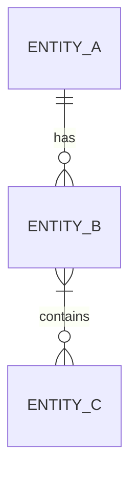

# Epic Template

## Purpose

Standard template for all epics in the KimyaÖğren product backlog.

---

## Epic {NN}: {Epic Name}

### Purpose
> One paragraph describing what this epic delivers and why it matters.

---

## User Stories

| ID | Story | Points | Priority | Sprint |
|----|-------|--------|----------|--------|
| {NN}.1 | As a {role}, I want to {action}, so that {benefit} | {1-8} | Must/Should/Could | {N} |
| {NN}.2 | ... | ... | ... | ... |

---

## Acceptance Criteria (Epic Level)

- [ ] Criterion 1
- [ ] Criterion 2
- [ ] Criterion 3

---

## Data Model (if applicable)

### Key Entities

| Entity | Key Fields |
|--------|------------|
| EntityA | `field1`, `field2`, `field3` |
| EntityB | `entity_a_id`, `field1`, `field2` |

---

## Filament Resources (if admin-facing)

| Resource | Relation Managers | Key Features |
|----------|-------------------|--------------|
| ResourceA | ResourceB | Feature 1, Feature 2 |
| ResourceB | - | Feature 3 |

---

## API Endpoints (if applicable)

| Method | Endpoint | Description |
|--------|----------|-------------|
| GET | `/api/{resource}` | List with filters |
| GET | `/api/{resource}/{id}` | Get single |
| POST | `/api/{resource}` | Create |
| PUT | `/api/{resource}/{id}` | Update |
| DELETE | `/api/{resource}/{id}` | Delete |

---

## Technical Requirements

### Database
- [ ] Migrations with FKs, indexes, constraints
- [ ] Enum casts
- [ ] Soft deletes
- [ ] Audit fields

### Filament Admin
- [ ] Navigation group
- [ ] Resource CRUD
- [ ] Relation managers
- [ ] Custom actions
- [ ] Filters & search

### API / Frontend
- [ ] Endpoints defined
- [ ] Validation rules
- [ ] Authorization policies
- [ ] Response resources

---

## Dependencies

| Dependency | Epic/Task | Required By |
|------------|-----------|-------------|
| {Epic/Task} | {ID} | {Sprint/Story} |

---

## Risks & Mitigations

| Risk | Likelihood | Impact | Mitigation |
|------|------------|--------|------------|
| Risk description | Low/Med/High | Low/Med/High | Mitigation strategy |

---

## Definition of Done (Epic)

- [ ] All stories complete per DoD
- [ ] Integration tested
- [ ] Performance targets met
- [ ] Accessibility targets met
- [ ] Documentation updated
- [ ] Deployed to staging
- [ ] PM sign-off

---

## Metrics

| Metric | Target |
|--------|--------|
| {Metric name} | {Target value} |

---

## Notes

> Additional context, decisions, or open questions.

---

*Template version 1.0. Copy to `docs/05-backlog/epic-{NN}-{kebab-case-name}.md`*