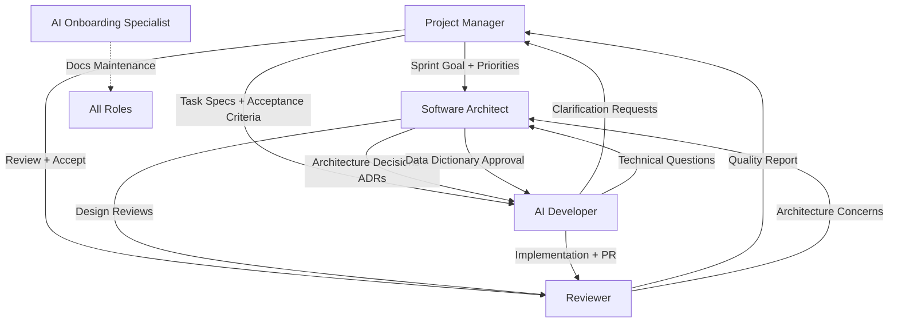

# Project Roles Documentation

## Overview
This directory defines all roles in the KimyaÖğren project, their responsibilities, authority boundaries, and interaction patterns.

---

## Role Catalog

| Role | File | Primary Focus |
|------|------|---------------|
| **Project Manager** | [project-manager.md](project-manager.md) | Product direction, priorities, scope, stakeholder communication |
| **Software Architect** | [software-architect.md](software-architect.md) | System architecture, technical decisions, domain modeling, standards |
| **AI Developer** | [ai-developer.md](ai-developer.md) | Task implementation, code quality, testing, workflow compliance |
| **Reviewer** | [reviewer.md](reviewer.md) | Code review, quality gates, architecture compliance, documentation |
| **AI Onboarding Specialist** | [ai-onboarding-specialist.md](ai-onboarding-specialist.md) | AI onboarding documentation maintenance |

---

## Interaction Model

---

## Decision Authority Matrix

| Decision Area | PM | Architect | AI Developer | Reviewer |
|---------------|-----|-----------|--------------|----------|
| Sprint scope | **Decide** | Advise | Execute | — |
| Backlog priority | **Decide** | Advise | — | — |
| Release timing | **Decide** | Advise | — | — |
| Architecture | Advise | **Decide** | Implement | Review |
| Data Dictionary | Approve | **Decide** | Draft | Review |
| API contracts | Approve | **Decide** | Implement | Review |
| Code implementation | — | Standards | **Decide** | Review |
| Technical approach | — | **Decide** | Propose | Review |
| Code quality | — | Standards | Write | **Gate** |
| Merge approval | — | — | — | **Gate** |
| Acceptance | **Decide** | — | — | Verify |

---

## Communication Protocols

### Async First
- All requests via GitHub Issues/PRs
- Slack for urgent/blocking only
- Document decisions in ADRs

### Escalation Path
1. **AI Developer** → PM (requirements) / Architect (technical)
2. **Reviewer** → Architect (architecture) / PM (scope)
3. **Architect** ↔ PM (trade-offs)
4. **All** → Leadership (resource/strategic)

### Meeting Cadence
| Meeting | Frequency | Participants |
|---------|-----------|--------------|
| Sprint Planning | Bi-weekly | PM, Architect, AI Developer |
| Daily Standup (async) | Daily | AI Developer → PM |
| Mid-Sprint Check | Weekly | PM, AI Developer |
| Sprint Review | Bi-weekly | All |
| Retrospective | Bi-weekly | All |
| Architecture Review | As needed | Architect, PM, AI Developer |

---

## Onboarding Sequence for New Team Members

| Step | Role | Responsible |
|------|------|-------------|
| 1. Read AGENTS.md + docs/ai/01-10 | All | Self |
| 2. Read role definition | All | Self |
| 3. Shadow 1 sprint | AI Developer | PM |
| 4. First PR with supervision | AI Developer | Reviewer |
| 5. Independent work | AI Developer | — |

---

## Role Collaboration Principles

| Principle | Practice |
|-----------|----------|
| **No surprises** | Communicate early, often, async |
| **Explicit over implicit** | Document decisions, assumptions |
| **Disagree and commit** | Debate openly, then commit |
| **Single source of truth** | Documentation = specification |
| **Continuous improvement** | Retrospectives drive process changes |

---

## Cross-Reference Map

| Document | Referenced By |
|----------|---------------|
| AGENTS.md | All AI assistants |
| docs/ai/01-role-definition.md | All AI assistants |
| project-manager.md | PM, Architect, AI Developer |
| software-architect.md | PM, AI Developer, Reviewer |
| ai-developer.md | PM, Architect, Reviewer |
| reviewer.md | PM, Architect, AI Developer |
| ai-onboarding-specialist.md | All |

---

## Revision History
| Version | Date | Author | Changes |
|---------|------|--------|---------|
| 1.0 | 2024-01-17 | AI Assistant | Initial creation |

---