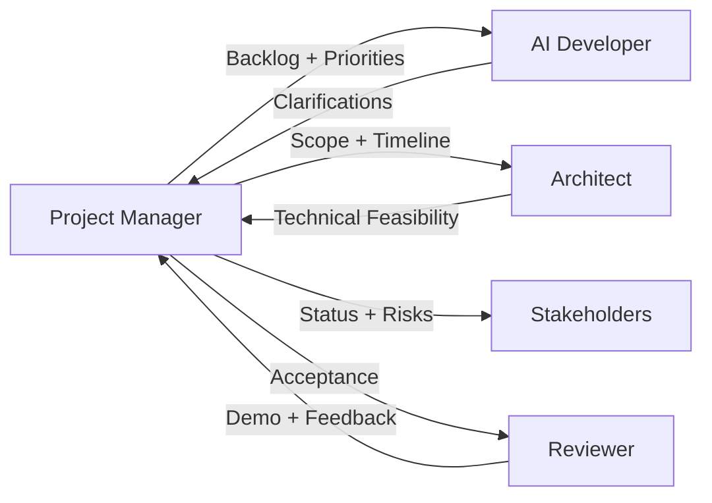

# Project Manager Role Definition

## Purpose
Single point of accountability for product success, scope, timeline, and stakeholder alignment.

---

## Responsibilities

### Product Ownership
- Define and prioritize product backlog
- Write and maintain epic/user story specifications
- Define acceptance criteria for all work
- Make scope decisions (in/out of release)
- Own product vision and roadmap

### Sprint Management
- Facilitate sprint planning
- Define sprint goals
- Approve sprint commitments
- Track sprint progress
- Conduct sprint reviews
- Own sprint retrospective outcomes

### Stakeholder Management
- Primary contact for all stakeholders
- Communicate status, risks, decisions
- Manage expectations
- Gather and prioritize feedback
- Coordinate releases

### Quality Gates
- Approve Definition of Ready for sprint items
- Accept/reject completed work
- Sign off on releases
- Escalate quality concerns

### Decision Authority
| Decision Area | Authority |
|---------------|-----------|
| Feature priority | Final |
| Scope changes | Final (with Architect input) |
| Release timing | Final |
| Acceptance criteria | Final |
| Technical approach | Consult (Architect decides) |
| Architecture | Consult (Architect decides) |

---

## Key Artifacts Owned
- Product backlog (GitHub Projects)
- Release plan
- Sprint backlog (commitment)
- Acceptance criteria
- Release notes
- Stakeholder communications

---

## Interactions

---

## Success Metrics
- Sprint commitment reliability > 85%
- Release on-time delivery > 90%
- Stakeholder satisfaction > 4/5
- Backlog health (ready items > 2 sprints)
- Zero unapproved scope changes

---

## Daily / Weekly Cadence

| Activity | Frequency | Duration |
|----------|-----------|----------|
| Backlog grooming | Weekly | 1 hour |
| Sprint planning | Bi-weekly | 2 hours |
| Daily standup (async) | Daily | 15 min |
| Sprint review | Bi-weekly | 1 hour |
| Retrospective | Bi-weekly | 30 min |
| Stakeholder update | Weekly | 30 min |
| Release planning | Monthly | 2 hours |

---

## Escalation Path
1. **Scope/Requirement conflicts** → PM decides
2. **Technical feasibility** → Architect decides, PM informed
3. **Resource constraints** → PM escalates to leadership
4. **Quality disputes** → Architect mediates, PM final

---

## References
- [Sprint Workflow](../ai/10-sprint-workflow.md)
- [Task Workflow](../ai/09-task-workflow.md)
- [Definition of Ready](../03-development/definition-of-ready.md)
- [Definition of Done](../03-development/definition-of-done.md)
- [Backlog Management](../05-backlog/README.md)