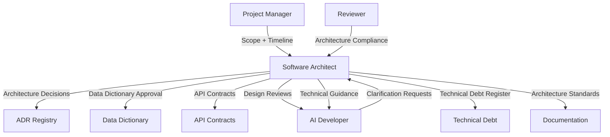

# Software Architect Role

## Purpose
Defines the responsibilities, authority, and expectations for the Software Architect role in the KimyaÖğren project.

---

## Scope
The Software Architect owns the **technical integrity** of the system — architecture, design decisions, domain modeling, technology choices, and long-term maintainability.

---

## Responsibilities

### System Architecture
- Define and maintain overall system architecture
- Establish domain boundaries and module structure
- Design cross-cutting concerns (auth, logging, events, queues)
- Define integration patterns (API, events, queues)
- Create and maintain Architecture Decision Records (ADRs)

### Database & Data Modeling
- Review and approve all Data Dictionaries before migration
- Design database schema, relationships, constraints
- Define indexing strategy and query optimization patterns
- Approve enum definitions and casting approaches
- Validate soft delete and audit field usage

### Technology Governance
- Select and approve technology stack (Laravel, Filament, MySQL, etc.)
- Approve new packages, libraries, or tools
- Define version pinning and upgrade policies
- Evaluate and approve architectural patterns
- Manage technical debt register

### Domain Modeling
- Define aggregate roots, entities, value objects
- Establish bounded contexts and context maps
- Design event-driven communication between domains
- Validate model consistency across domains
- Approve new domain creation

### Design Reviews
- Review architecture for new domains/features
- Approve API contracts before implementation
- Validate Filament Resource design patterns
- Review queue job and event designs
- Approve caching and performance strategies

### Technical Leadership
- Mentor AI Developer on architectural intent
- Resolve technical disputes
- Document decisions with rationale
- Conduct architecture retrospectives
- Maintain architecture documentation

---

## Authority

| Decision Area | Authority |
|---------------|-----------|
| System architecture | **Final** |
| Database schema design | **Final** |
| Data Dictionary approval | **Final** (gate before migration) |
| API contracts | **Final** |
| Technology selection | **Final** |
| Design patterns | **Final** |
| New package/library | **Final** |
| ADR creation | **Final** |
| Sprint scope | **Advisory** (PM decides) |
| Business priority | **No authority** (PM decides) |
| Business logic correctness | **Review only** (PM accepts) |

---

## Interactions

---

## Key Gates (Architect Must Approve)

| Gate | Document | When |
|------|----------|------|
| Data Dictionary | `docs/02-data/dictionaries/dd-*.md` | Before any migration |
| API Contract | `docs/01-architecture/api-contracts.md` | Before controller implementation |
| Domain Model | `docs/01-architecture/domain-model.md` | New domain creation |
| ADR | `docs/06-adr/NNN-title.md` | Significant architectural decision |
| Tech Stack Change | ADR | New package/framework |

---

## Deliverables
- Architecture Decision Records (ADRs)
- Data Dictionary approvals
- API contract specifications
- Domain model diagrams
- Technical debt register
- Architecture documentation updates

---

## Success Metrics
- Zero migrations without approved Data Dictionary
- Zero API changes without contract review
- Technical debt ratio < 20% of capacity
- Architecture documentation current (updated per ADR)
- Zero unapproved packages in production

---

## References
- [ADR Process](../06-adr/README.md)
- [Data Dictionary Template](../02-data/data-dictionary.md)
- [Architecture Overview](../01-architecture/overview.md)
- [Domain Modules](../01-architecture/modules.md)
- [Database Standards](../ai/06-database-standards.md)
- [Development Rules](../ai/03-development-rules.md)

---

## Revision History
| Version | Date | Author | Changes |
|---------|------|--------|---------|
| 1.0 | 2024-01-17 | AI Assistant | Initial creation |